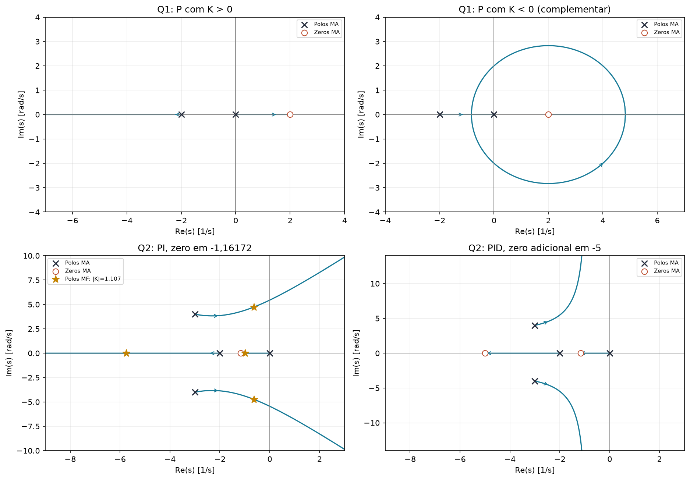

# 2023.1 — resolução didática

[Voltar ao roteiro](../README.md) · [Enunciado](<EL466 Prova da 2ª Unidade, 2023.1 questoes.pdf>) · [Resolução fornecida](<EL466 Prova da 2ª Unidade, 2023.1 resolucoes.pdf>)

**Aplicação:** 30/08/2023. **Questões:** 2. **Papel no estudo:** LGR com ganho negativo, fase não mínima e PI/PID por sintonia heurística.

As explicações seguem a sequência do material, com conferências adicionais explicitamente identificadas. Todos os sistemas usam realimentação negativa unitária.

## Questão 1 — braço robótico, 4 pontos

$$G(s)=\frac{s-2}{s(s+2)}.$$

O zero $+2$ está no semiplano direito: a planta é de fase não mínima. O integrador em $s=0$ dá tipo 1 se não for cancelado.

### a) P com ganho positivo e negativo

Com $G_c=K_p$:

$$L=\frac{K_p(s-2)}{s(s+2)},\qquad
\Delta=s^2+(2+K_p)s-2K_p.$$

**Para $K_p>0$:** polos de MA em $0,-2$ e zero em $+2$. Pela regra ímpar, os trechos reais são $(-\infty,-2)$ e $(0,2)$. Um polo vai da origem para $+2$: a malha é instável para todo ganho positivo.

**Para $K_p<0$:** escreva $k=-K_p>0$. Use o LGR complementar: trecho real $(-2,0)$ e também $(2,\infty)$, assíntota a $0^\circ$. Os polos inicialmente entram no semiplano esquerdo, deixam o eixo real e depois cruzam o eixo imaginário.

**Conferência algébrica, além do esboço pedido:** uma quadrática mônica é estável se os dois coeficientes restantes forem positivos:

$$2+K_p>0,\quad -2K_p>0
\Rightarrow \boxed{-2<K_p<0.}$$

No limite $K_p=-2$, $\Delta=s^2+4$ e os polos são $\pm j2$.

### b) Tempo crítico estimado sem refinamento

O enunciado pede esboço sem refinar e manda desprezar o zero no cálculo de $T_s$. O gabarito aproxima o encontro dos polos pelo ponto médio entre $-2$ e 0: $s\approx-1$.

Logo, $\zeta=1$, $\omega_n\approx1$:

$$\boxed{T_s(1\%)\approx\frac{11,113-4,388}{1}=6,725\ \mathrm{s}.}$$

**Não memorize $-1$ como ponto exato.** Refinando, o polo duplo é $2-2\sqrt2\approx-0,828427$, com $K_p=-6+4\sqrt2\approx-0,343146$. Isso não invalida a estimativa solicitada, mas mostra seu grau de aproximação.

### c) Escolher PD para acelerar

Use o zero para cancelar o polo estável em $-2$: $z=2$.

$$G_c=K_d(s+2),\qquad L=\frac{K_d(s-2)}s.$$

A equação característica reduzida é:

$$s+K_d(s-2)=0\Rightarrow s=\frac{2K_d}{1+K_d}.$$

Para estabilidade, escolha $-1<K_d<0$. Queremos, por exemplo, polo em $-5$:

$$-5=\frac{2K_d}{1+K_d}
\Rightarrow -5-5K_d=2K_d
\Rightarrow \boxed{G_c=-\frac57(s+2).}$$

Pelo raciocínio simplificado de polo, $T_s\approx5/5=1$ s, muito menor que 6,725 s.

**Conferência da resposta completa:** a FTMF reduzida é

$$T(s)=\frac{-2,5s+5}{s+5},\qquad y(t)=1-3,5e^{-5t}.$$

Portanto $T_s(1\%)=\ln(350)/5\approx1,172$ s. O zero não mínimo e a passagem direta alteram a amplitude inicial; a melhoria permanece. O modelo ideal prevê salto inicial negativo. O polo cancelado em $-2$ é estável.

## Questão 2 — conversor fotovoltaico, 6 pontos

$$G(s)=\frac{100}{(s^2+6s+25)(s+2)}.$$

### a) Controlador mais simples

A planta é tipo 0. Para erro de degrau nulo, precisamos acrescentar integração. Entre P, PI e PID, escolha:

$$\boxed{G_c=K_p+\frac{K_i}s=K_p\frac{s+z}{s}.}$$

### b) Método de Ziegler–Nichols

Siga o método de malha fechada, como no material. A planta permite um ganho crítico finito com P, calculado a seguir. A justificativa segura é verificar essa condição e considerar a forma da resposta, sem tomar “tem polo complexo” como regra universal de exclusão da malha aberta.

### c) Sintonia do PI

Durante a busca de $K_{cr}$, use **P puro**:

$$\Delta=(s+2)(s^2+6s+25)+100K
=s^3+8s^2+37s+50+100K.$$

| Linha | Coluna 1 | Coluna 2 |
|---|---|---|
| $s^3$ | 1 | 37 |
| $s^2$ | 8 | $50+100K$ |
| $s^1$ | $(246-100K)/8$ | 0 |
| $s^0$ | $50+100K$ | 0 |

$$K_{cr}=2,46.$$

Auxiliar:

$$8s^2+296=0\Rightarrow\omega_{cr}=\sqrt{37},\qquad
P_{cr}=\frac{2\pi}{\sqrt{37}}\approx1,03295.$$

Tabela de PI:

$$K_p=0,45K_{cr}=1,107,\quad T_i=P_{cr}/1,2\approx0,86079.$$

$$K_i=K_p/T_i\approx1,28603,\quad z=1/T_i\approx1,16172.$$

$$\boxed{G_c\approx1,107+\frac{1,28603}{s}.}$$

### d) LGR com o ganho novamente variável

Conserve o zero e varie apenas o ganho:

$$L=\frac{100K(s+1,16172)}{s(s+2)(s^2+6s+25)}.$$

- Polos: $0,-2,-3\pm j4$.
- Zero: $-1,16172$.
- Trechos reais: $(-\infty,-2)$ e $(-1,16172,0)$.
- Três assíntotas: $60^\circ,180^\circ,300^\circ$.
- Centroide: $(-8+1,16172)/3=-2,27943$.

Um ramo vai de 0 ao zero; outro vai de $-2$ a $-\infty$; o par complexo cruza o eixo imaginário para ganho suficientemente alto.

### e) Faixa estável e cruzamento

$$\Delta=s^4+8s^3+37s^2+(50+100K)s+100zK.$$

Defina:

$$B=\frac{246-100K}{8},\qquad
C=\frac{B(50+100K)-800zK}{B}.$$

Primeira coluna: $1,8,B,C,100zK$.

Para $K>0$, precisamos $K<2,46$ e:

$$F(K)=(246-100K)(50+100K)-6400zK>0.$$

Com $z=1,161722$:

$$F(K)=12300+12164,9788K-10000K^2.$$

A raiz positiva é aproximadamente 1,873147; a negativa é irrelevante para $K>0$:

$$\boxed{0<K<1,873147.}$$

No limite, o auxiliar $Bs^2+100zK=0$ fornece:

$$\boxed{s=\pm j5,44650.}$$

O PI heurístico usa $K=1,107$, dentro da faixa estável.

### f) Adicionar um zero em −5

$$G_c=K\frac{(s+1,16172)(s+5)}s.$$

Agora há dois zeros e duas assíntotas verticais:

$$\sigma_a=\frac{-8-(-1,16172-5)}2=-0,91914.$$

Trechos reais: $(-5,-2)$ e $(-1,16172,0)$. Os dois ramos restantes vão ao infinito junto às assíntotas no semiplano esquerdo.

**Conferência de estabilidade:** os coeficientes da quártica são

$$a=8,\quad b=37+100K,\quad
c=50+100(5+z)K,\quad d=500zK.$$

$$ab-c=246+100(3-z)K>0.$$

O numerador da condição seguinte é:

$$c(ab-c)-64d
=12300+(138000-12400z)K+10000(5+z)(3-z)K^2.$$

Para $z=1,16172$, todos os coeficientes são positivos. Assim:

$$\boxed{\text{estável para todo }K>0.}$$

A faixa de estabilidade aumentou, mas isso não afirma que todo ganho dará um transitório bom.

## O que tirar desta prova

- Ganho negativo exige LGR complementar.
- Um zero no semiplano direito altera bastante a interpretação do transitório.
- $K_{cr}$ da busca com P é diferente do limite de ganho da malha com PI.
- Routh confirma uma conclusão de estabilidade que o desenho apenas sugere.
