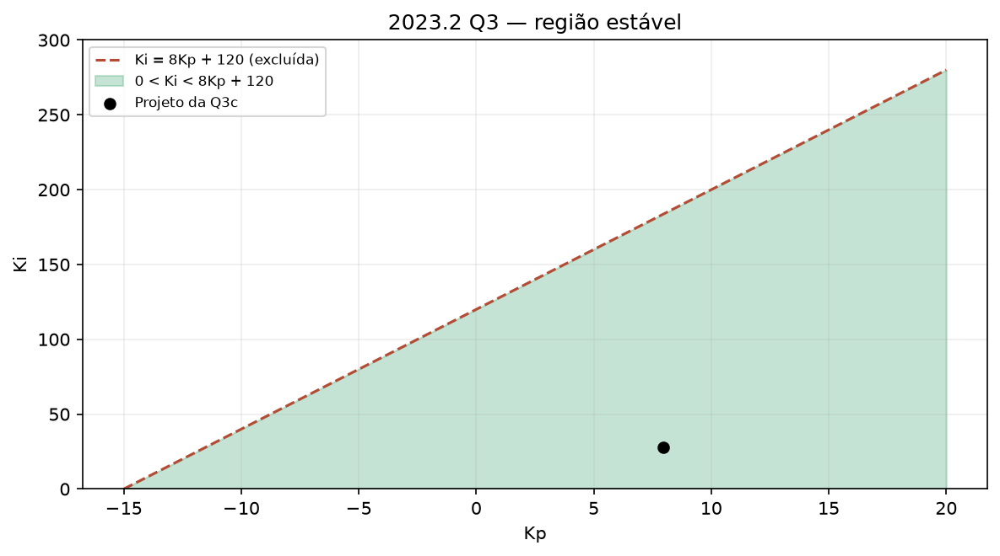

# 2023.2 — resolução didática

[Voltar ao roteiro](../README.md) · [Enunciado](<EL466 Prova da 2ª Unidade, 2023.2 questoes.pdf>) · [Resolução fornecida](<EL466 Prova da 2ª Unidade, 2023.2 resolucoes.pdf>)

**Aplicação:** 19/02/2024. O período acadêmico continua sendo 2023.2. **Questões:** 3.

## Questão 1 — erro e oscilação quando o ganho dobra, 2,5 pontos

$$L(s)=\frac{K}{(s+40)(s+a)(s+b)},\qquad K>0,\ a,b\ge0.$$

### Passo 1: traduza as exigências de erro

Erro de degrau nulo e erro de rampa constante não nulo exigem **exatamente um integrador**. Podemos escolher $a=0$, $b>0$.

$$L=\frac{K}{s(s+40)(s+b)}.$$

Também existe a solução simétrica trocando $a$ e $b$; não há diferença física no produto.

### Passo 2: traduza período em frequência

$$P=\frac\pi{10}\Rightarrow\omega=\frac{2\pi}{P}=20\ \mathrm{rad/s}.$$

O requisito de oscilação vale para **$2K$**, não para $K$.

$$\Delta_{2K}=s^3+(40+b)s^2+40bs+2K.$$

### Passo 3: aplique Routh

| Linha | Coluna 1 | Coluna 2 |
|---|---|---|
| $s^3$ | 1 | $40b$ |
| $s^2$ | $40+b$ | $2K$ |
| $s^1$ | $[(40+b)40b-2K]/(40+b)$ | 0 |
| $s^0$ | $2K$ | 0 |

Linha $s^1$ nula:

$$2K=(40+b)40b.$$

O auxiliar da linha $s^2$ é $(40+b)s^2+2K$. Para raízes $\pm j20$:

$$\frac{2K}{40+b}=400.$$

Comparando as duas expressões: $40b=400$, portanto $b=10$ e $2K=20000$.

$$\boxed{a=0,\ b=10,\ K=10000}
\quad\text{ou}\quad
\boxed{a=10,\ b=0,\ K=10000.}$$

### Passo 4: confira as três condições

Com ganho nominal, $K_v=10000/(40\cdot10)=25$, então:

$$e_{\rm degrau}=0,\qquad e_{\rm rampa}=1/25=0,04.$$

Routh nominal: $50\cdot400>10000$, portanto estável.

Com ganho dobrado:

$$\Delta_{2K}=(s+50)(s^2+400),$$

que tem o par imaginário pedido e o terceiro polo estável.

## Questão 2 — PID por ZN, 2,5 pontos

$$G(s)=\frac1{s(s^2+10s+26)}.$$

### a) Escolha do método

Há integrador na planta. O degrau em malha aberta não converge a um patamar, inviabilizando a curva de reação clássica. Use ZN de malha fechada.

### b) Cálculo dos ganhos

Com P puro:

$$\Delta=s^3+10s^2+26s+K.$$

Routh:

| Linha | Coluna 1 | Coluna 2 |
|---|---|---|
| $s^3$ | 1 | 26 |
| $s^2$ | 10 | $K$ |
| $s^1$ | $(260-K)/10$ | 0 |
| $s^0$ | $K$ | 0 |

$$K_{cr}=260,\quad A(s)=10s^2+260,\quad
\omega_{cr}=\sqrt{26}.$$

$$P_{cr}=\frac{2\pi}{\sqrt{26}}\approx1,232234.$$

ZN clássico:

$$K_p=156,\quad T_i=0,616117,\quad T_d=0,154029.$$

$$K_i=253,198658,\qquad K_d=24,028563.$$

$$\boxed{G_c(s)=156+\frac{253,198658}{s}+24,028563s.}$$

Observe que o controlador final acrescenta mais um integrador; a busca de $K_{cr}$ foi feita antes disso, com P puro.

## Questão 3 — PI, região estável e polos com parte real −2, 5 pontos

$$G(s)=\frac1{(s+3)(s+5)}.$$

### a) Controlador mais simples entre os oferecidos

A planta é tipo 0. Precisamos de tipo 1 para degrau sem erro e rampa com erro constante. P e PD não acrescentam integração; avanço e atraso usuais também não têm polo exatamente na origem. Entre as alternativas, escolha:

$$\boxed{G_c=K_p\frac{s+z}{s}=K_p+\frac{K_i}{s},\quad K_i=K_pz.}$$

### b) Região de estabilidade

$$\Delta=s(s+3)(s+5)+K_p s+K_i
=s^3+8s^2+(15+K_p)s+K_i.$$

| Linha | Coluna 1 | Coluna 2 |
|---|---|---|
| $s^3$ | 1 | $15+K_p$ |
| $s^2$ | 8 | $K_i$ |
| $s^1$ | $(120+8K_p-K_i)/8$ | 0 |
| $s^0$ | $K_i$ | 0 |

$$\boxed{0<K_i<120+8K_p.}$$

Isso implica $K_p>-15$. No plano $K_p\times K_i$, a região está acima de $K_i=0$ e abaixo da reta $K_i=120+8K_p$, sem as fronteiras.

Na parametrização usual $K_p,z>0$:

$$\boxed{K_p>0,\quad 0<z<8+\frac{120}{K_p}.}$$

Se forem admitidos ganhos negativos, a descrição geral $0<K_pz<120+8K_p$ precisa ser separada por sinal ao dividir por $K_p$. A forma $(K_p,K_i)$ evita essa dificuldade.

### c) Erro de rampa 0,5387 e par em −2 ± jω

Primeiro use o erro, pois ele determina $K_i$ diretamente:

$$K_v=\lim sL=\frac{K_i}{15},\quad
e_{ss}=\frac{15}{K_i}=0,5387.$$

$$K_i=\frac{15}{0,5387}\approx27,844812.$$

Agora precisamos do par com parte real $-2$. Faça $q=s+2$:

$$\Delta(q-2)=q^3+2q^2+(K_p-5)q+(K_i-2K_p-6).$$

A linha $q^1$ de Routh é proporcional a:

$$2(K_p-5)-(K_i-2K_p-6)=4K_p-K_i-4.$$

Para zerá-la:

$$K_p=1+\frac{K_i}{4}\approx7,961203.$$

Auxiliar:

$$2q^2+K_i-2K_p-6=0
\Rightarrow q^2=4-\frac{K_i}{4}.$$

Como $K_i>16$, as raízes são imaginárias:

$$\omega_p=\sqrt{\frac{K_i}{4}-4}\approx1,720815.$$

Voltando ao plano original:

$$\boxed{p_{1,2}=-2\pm j1,720815.}$$

O terceiro polo é $-4$, pois a soma dos polos é $-8$.

O zero do PI fica em:

$$-z=-\frac{K_i}{K_p}\approx-3,4976.$$

$$\boxed{G_c(s)\approx7,961203+\frac{27,844812}{s}.}$$

**Conferência por fatoração:** $\Delta=(s+4)[s^2+4s+K_i/4]$. Isso confirma o terceiro polo, a parte real do par e o termo constante.

O par é o mais próximo do eixo imaginário, como pedido. Isso não significa que o polo $-4$ esteja a cinco vezes a distância; não use uma aproximação de segunda ordem sem essa ressalva.

## O que tirar desta prova

- O período de oscilação fornece uma equação independente da condição de Routh.
- Distinguir $K$ de $2K$ evita perder a questão inteira.
- O erro pode determinar $K_i$ antes do restante do projeto.
- Transladar o eixo transforma “parte real $-2$” em um problema conhecido de polos imaginários.
