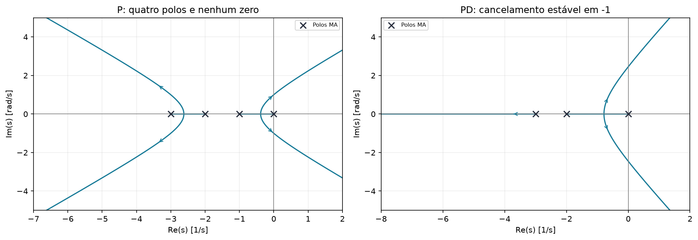
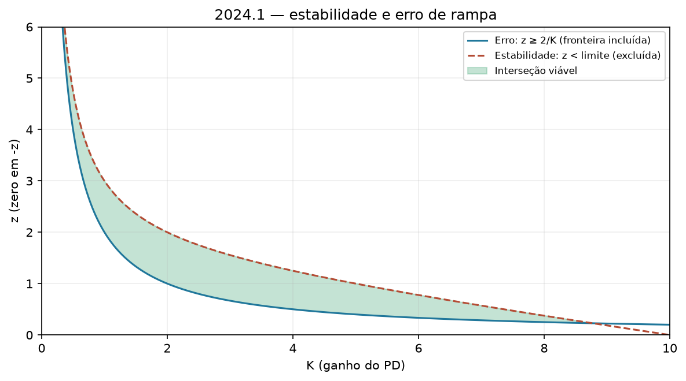
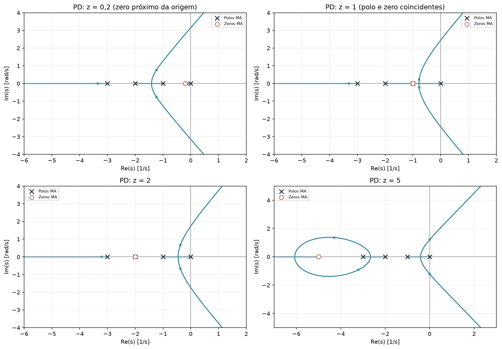

# 2024.1 — resolução didática

[Voltar ao roteiro](../README.md) · [Enunciado](<EL466 Prova da 2ª Unidade, 2024.1 questoes.pdf>) · [Resolução fornecida](<EL466 Prova da 2ª Unidade, 2024.1 resolucoes.pdf>)

**Aplicação:** 10/07/2024. **Questões:** 2. Esta é uma boa primeira prova para estudar estabilidade ∩ erro.

## Questão 1 — fresa, 7 pontos

$$G(s)=\frac6{s(s+1)(s+2)(s+3)}
=\frac6{s^4+6s^3+11s^2+6s}.$$

### a) P: estabilidade e erro de rampa ≤ 0,5

Com $G_c=K_p$:

$$K_v=\lim_{s\to0}sK_pG(s)=K_p.$$

$$e_{ss}=1/K_p\le0,5\Rightarrow K_p\ge2.$$

Agora verifique se esses ganhos são estáveis:

$$\Delta=s^4+6s^3+11s^2+6s+6K_p.$$

| Linha | Coluna 1 | Coluna 2 | Coluna 3 |
|---|---|---|---|
| $s^4$ | 1 | 11 | $6K_p$ |
| $s^3$ | 6 | 6 | 0 |
| $s^2$ | 10 | $6K_p$ | 0 |
| $s^1$ | $(60-36K_p)/10$ | 0 | 0 |
| $s^0$ | $6K_p$ | 0 | 0 |

$$0<K_p<5/3.$$

Não há interseção com $K_p\ge2$:

$$\boxed{\text{Nenhum controlador P atende simultaneamente às duas exigências.}}$$

Essa é uma resposta completa, não um sinal de que você errou a conta.

### b) LGR e transitórios com P

- Polos em $0,-1,-2,-3$; nenhum zero finito.
- Trechos reais: $(-1,0)$ e $(-3,-2)$.
- Centroide $-1,5$; assíntotas a $45^\circ,135^\circ,225^\circ,315^\circ$.
- No limite $K_p=5/3$, o auxiliar dá $s=\pm j$.

**Interpretação em ordem crescente de ganho:**

1. Ganho pequeno: polo perto da origem domina, comportamento aproximadamente de primeira ordem, sem sobressinal e lento. Se $p\approx-0,1$, o material estima $T_s(1\%)\approx50$ s.
2. Antes da saída do eixo: dois polos reais dominantes, resposta sobreamortecida.
3. Na saída: par real repetido, aproximadamente crítico.
4. Depois da saída: par complexo; inicialmente pode haver pequeno sobressinal e tempo menor; perto de $5/3$, a resposta fica pouco amortecida e muito lenta.
5. Acima do limite: instável.

**Estimativa do gabarito:** tomando o encontro em $-0,5$, obtém $T_s\approx13,45$ s no caso crítico; para aproximadamente 1% de sobressinal, cita cerca de 10,68 s.

**Conferência refinada:** o encontro não é exatamente o ponto médio. De

$$K_p(s)=-[s^4+6s^3+11s^2+6s]/6,$$

vem $D'(s)=4s^3+18s^2+22s+6=0$. O encontro dominante é:

$$s=-0,381966,\quad K_p=1/6.$$

O formulário aplicado a esse polo daria $6,725/0,381966\approx17,61$ s como estimativa de segunda ordem. Portanto os tempos do esboço devem ser apresentados como aproximações, sem prometer precisão.

### c) PD: região estável e erro de rampa ≤ 0,5

$$G_c=K_d(s+z),\qquad K_d,z>0.$$

Erro:

$$K_v=K_dz\Rightarrow \boxed{z\ge2/K_d.}$$

Característica:

$$\Delta=s^4+6s^3+11s^2+(6+6K_d)s+6K_dz.$$

As primeiras linhas de Routh são:

| Linha | Coluna 1 | Coluna 2 | Coluna 3 |
|---|---|---|---|
| $s^4$ | 1 | $11$ | $6K_dz$ |
| $s^3$ | 6 | $6+6K_d$ | 0 |
| $s^2$ | $10-K_d$ | $6K_dz$ | 0 |
| $s^1$ | $[(10-K_d)(6+6K_d)-36K_dz]/(10-K_d)$ | 0 | 0 |
| $s^0$ | $6K_dz$ | 0 | 0 |

Para primeira coluna positiva:

$$K_d<10,\quad -K_d^2+9K_d+10-6K_dz>0.$$

$$\boxed{\frac2{K_d}\le z<
\frac{-K_d^2+9K_d+10}{6K_d}.}$$

A faixa precisa ter altura positiva:

$$-K_d^2+9K_d+10>12
\Rightarrow K_d^2-9K_d+2<0.$$

$$\boxed{\frac{9-\sqrt{73}}2<K_d<\frac{9+\sqrt{73}}2}
\approx(0,227998;\ 8,772002).$$

### d) Mover o zero e melhorar o transitório

- Zero muito próximo da origem: tende a deixar um ramo lento.
- Zero em $-1$: cancela nominalmente o polo lento não nulo.
- Zeros em $-2$ ou mais à esquerda mudam a geometria, mas não eliminam o polo lento em $-1$ da mesma maneira.

Com $z=1$:

$$L=\frac{6K_d}{s(s+2)(s+3)},\quad
\Delta_{\rm red}=s^3+5s^2+6s+6K_d.$$

O LGR reduzido tem centroide $-5/3$, assíntotas a $60^\circ,180^\circ,300^\circ$ e trechos reais $(-2,0)$ e $(-\infty,-3)$.

O ponto crítico exato do par dominante vem de:

$$3s^2+10s+6=0
\Rightarrow s=\frac{-5+\sqrt7}3=-0,784750.$$

$$K_d=-s(s+2)(s+3)/6\approx0,352102.$$

É aproximadamente duas vezes mais rápido em taxa de decaimento que o encontro do P, $-0,381966$. O formulário dá $T_s\approx8,57$ s; a resposta completa reduzida dá aproximadamente 8,78 s. O material estimava $s\approx-0,9$ e 7,47 s pelo esboço.

**Atenção à ligação com a letra c:** esse projeto crítico não satisfaz o erro de rampa de 0,5, pois $K_dz=0,352102<2$. É um exemplo de melhoria de transitório, não um ponto da região da letra c.

Se também mantivermos o erro, um ponto válido é $z=1,K_d=2$:

$$e_{ss}=0,5,\quad
p_{\rm red}\approx-4,25265,\;-0,37368\pm j1,63772.$$

A conferência completa dá $M_p\approx45,02\%$, $T_s(1\%)\approx12,16$ s. Ele atende estabilidade e erro, mas não é criticamente amortecido. O P da letra a não consegue sequer atender às duas restrições. Explique essa diferença para não apresentar um ganho fora da região como solução simultânea.

## Questão 2 — PID heurístico, 3 pontos

Polos da planta: $-2,-0,5\pm j$; ganho estático 2.

### a) Planta e escolha do método

$$G=\frac{A}{(s+2)(s^2+s+1,25)},\quad
G(0)=A/2,5=2\Rightarrow A=5.$$

A resposta fornecida apresenta oscilação e sobressinal. Use o método de malha fechada, cuja condição de oscilação sustentada será demonstrada.

### b) Sintonia

Com P:

$$\Delta=s^3+3s^2+3,25s+2,5+5K.$$

Routh impõe:

$$3\cdot3,25=2,5+5K_{cr}
\Rightarrow \boxed{K_{cr}=1,45.}$$

Auxiliar:

$$3s^2+9,75=0\Rightarrow\omega_{cr}=\sqrt{3,25}.$$

$$P_{cr}=3,485284,\quad
K_p=0,87,\quad T_i=1,742642,\quad T_d=0,435661.$$

$$K_i=0,499242,\quad K_d=0,379025.$$

$$\boxed{G_c(s)\approx0,87+\frac{0,499242}{s}+0,379025s.}$$

## O que tirar desta prova

O resultado mais importante é entender que erro, estabilidade e rapidez são exigências diferentes. Um projeto pode melhorar uma e piorar outra. Faça a interseção antes de anunciar que todos os requisitos foram atendidos.
