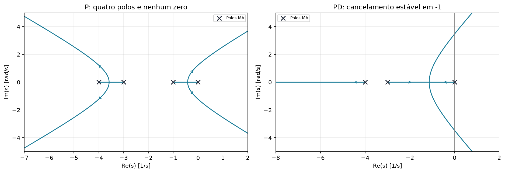
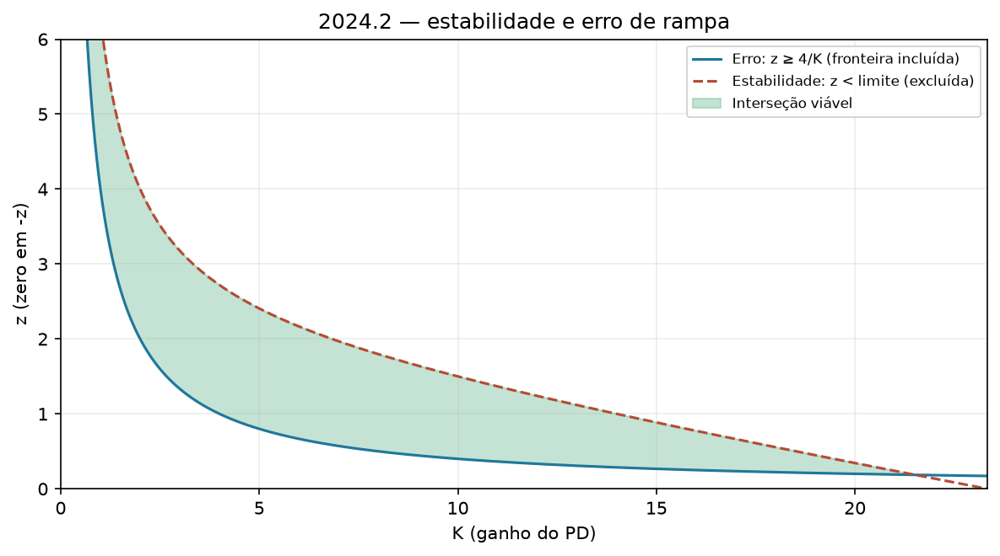

# 2024.2 — resolução didática

[Voltar ao roteiro](../README.md) · [Enunciado](<EL466 Prova da 2ª Unidade, 2024.2 questoes.pdf>) · [Resolução fornecida](<EL466 Prova da 2ª Unidade, 2024.2 resolucoes.pdf>)

**Aplicação:** 12/03/2025. **Questões:** 2. Compare com 2024.1: o método é o mesmo, mas desta vez o P consegue cumprir o erro em uma faixa estreita.

## Questão 1 — fresa, 7 pontos

$$G=\frac6{s(s+1)(s+3)(s+4)}
=\frac6{s^4+8s^3+19s^2+12s}.$$

### a) P: estabilidade ∩ erro

$$K_v=\lim sK_pG=K_p/2,\quad
e_{ss}=\frac2{K_p}\le0,5\Rightarrow K_p\ge4.$$

$$\Delta=s^4+8s^3+19s^2+12s+6K_p.$$

| Linha | Coluna 1 | Coluna 2 | Coluna 3 |
|---|---|---|---|
| $s^4$ | 1 | 19 | $6K_p$ |
| $s^3$ | 8 | 12 | 0 |
| $s^2$ | $17,5$ | $6K_p$ | 0 |
| $s^1$ | $(210-48K_p)/17,5$ | 0 | 0 |
| $s^0$ | $6K_p$ | 0 | 0 |

$$0<K_p<210/48=4,375.$$

Interseção:

$$\boxed{4\le K_p<4,375.}$$

O limite 4 entra porque o erro admite igualdade; 4,375 não entra porque a estabilidade pedida é estrita.

### b) LGR e respostas possíveis

- Polos: $0,-1,-3,-4$.
- Trechos reais: $(-1,0)$ e $(-4,-3)$.
- Centroide: $-2$.
- Assíntotas: $45^\circ,135^\circ,225^\circ,315^\circ$.
- Limite estável: $K_p=4,375$; auxiliar $17,5s^2+26,25=0$, isto é, $s=\pm j\sqrt{1,5}$.

Ao variar o ganho positivo, há comportamento aproximadamente de primeira ordem para ganho muito pequeno; depois pares reais dominantes, encontro crítico e par complexo. Próximo do limite, a oscilação é pouco amortecida e $T_s$ cresce.

O gabarito estima as saídas em $-0,5$ e $-3,5$. Sob essa aproximação:

| Exemplo do esboço | $M_p$ aproximado | $T_s(1\%)$ aproximado |
|---|---|---|
| Polo dominante em $-0,15$ | 0 | 33 s pela regra $5/|p|$ |
| Par real próximo de $-0,5$ | 0 | 14,19 s no exemplo sobreamortecido |
| Par repetido em $-0,5$ | 0 | 13,45 s |
| Par complexo com $\sigma\approx0,4$, $\zeta\approx0,826$ | 1% | 11 s |

**Conferência refinada:** $D'(s)=4s^3+24s^2+38s+12$. As saídas reais válidas são aproximadamente $-0,418861$ e $-3,581139$, ambas em $K_p=0,375$. O ponto $-2$ não pertence ao trecho real do LGR positivo. Logo, os pontos médios da tabela são estimativas, não raízes calculadas.

**Ligação com a letra a:** a faixa $4\le K_p<4,375$ está perto da perda de estabilidade. Não é a faixa de respostas críticas ou de baixo sobressinal. As várias classificações acima descrevem o LGR inteiro, não apenas os ganhos que cumprem o erro.

### c) PD: região estável com erro de rampa ≤ 0,5

$$G_c=K_d(s+z),\quad K_d,z>0.$$

$$K_v=K_dz/2,\quad e_{ss}=2/(K_dz)\le0,5
\Rightarrow z\ge4/K_d.$$

$$\Delta=s^4+8s^3+19s^2+(12+6K_d)s+6K_dz.$$

Com $q=12+6K_d$:

$$B=\frac{152-q}8=\frac{140-6K_d}8.$$

Condições de Routh:

$$B>0\Rightarrow K_d<70/3.$$

$$Bq-48K_dz>0.$$

Multiplicando por 8 e simplificando por 4:

$$-9K_d^2+192K_d+420-96K_dz>0.$$

Portanto:

$$\boxed{\frac4{K_d}\le z<
\frac{-9K_d^2+192K_d+420}{96K_d}.}$$

Para existir intervalo:

$$-9K_d^2+192K_d+420>384
\Rightarrow9K_d^2-192K_d-36<0.$$

As raízes são $-0,185880$ e $21,519214$. No primeiro quadrante:

$$\boxed{0<K_d<21,519214.}$$

**Ponto de conferência:** $K_d=4,z=1$. Temos $K_dz=4$ e a fronteira superior vale 2,71875, maior que 1. Logo o ponto é estável e tem erro exatamente 0,5.

## Questão 2 — PID heurístico, 3 pontos

Polos: $-2,-1,5\pm j$; $G(0)=2$.

### a) Monte a planta e justifique o método

$$G=\frac{A}{(s+2)(s^2+3s+3,25)},\quad
A/6,5=2\Rightarrow A=13.$$

Siga a sintonia de malha fechada do gabarito. Há ganho crítico finito verificável analiticamente. O gráfico fornecido parece quase monótono; não use apenas a frase “há polos complexos” para concluir que qualquer aplicação de malha aberta seria impossível. A justificativa inequívoca aqui é a existência do limite oscilatório para o método escolhido.

### b) Calcule Kcr, Pcr e os três ganhos

Com P puro:

$$\Delta=s^3+5s^2+9,25s+6,5+13K.$$

Tabela de Routh de terceira ordem:

$$5\cdot9,25-(6,5+13K_{cr})=0.$$

$$K_{cr}=\frac{39,75}{13}=3,057692.$$

Auxiliar:

$$5s^2+46,25=0\Rightarrow \omega_{cr}=\sqrt{9,25}.$$

$$P_{cr}=\frac{2\pi}{\sqrt{9,25}}=2,065899.$$

$$K_p=0,6K_{cr}=1,834615,\quad
T_i=P_{cr}/2=1,032949,\quad T_d=P_{cr}/8=0,258237.$$

$$K_i=K_p/T_i=1,776094,\quad K_d=K_pT_d=0,473766.$$

$$\boxed{G_c(s)\approx1,834615+\frac{1,776094}{s}+0,473766s.}$$

Pequenas diferenças nas últimas casas em relação ao PDF decorrem de arredondar os tempos antes de calcular os ganhos.

## O que tirar desta prova

A mesma receita de 2024.1 produz outra conclusão. O P agora satisfaz erro e estabilidade, mas só perto do limite oscilatório. É por isso que estabilidade e erro não bastam para garantir um transitório desejável.
