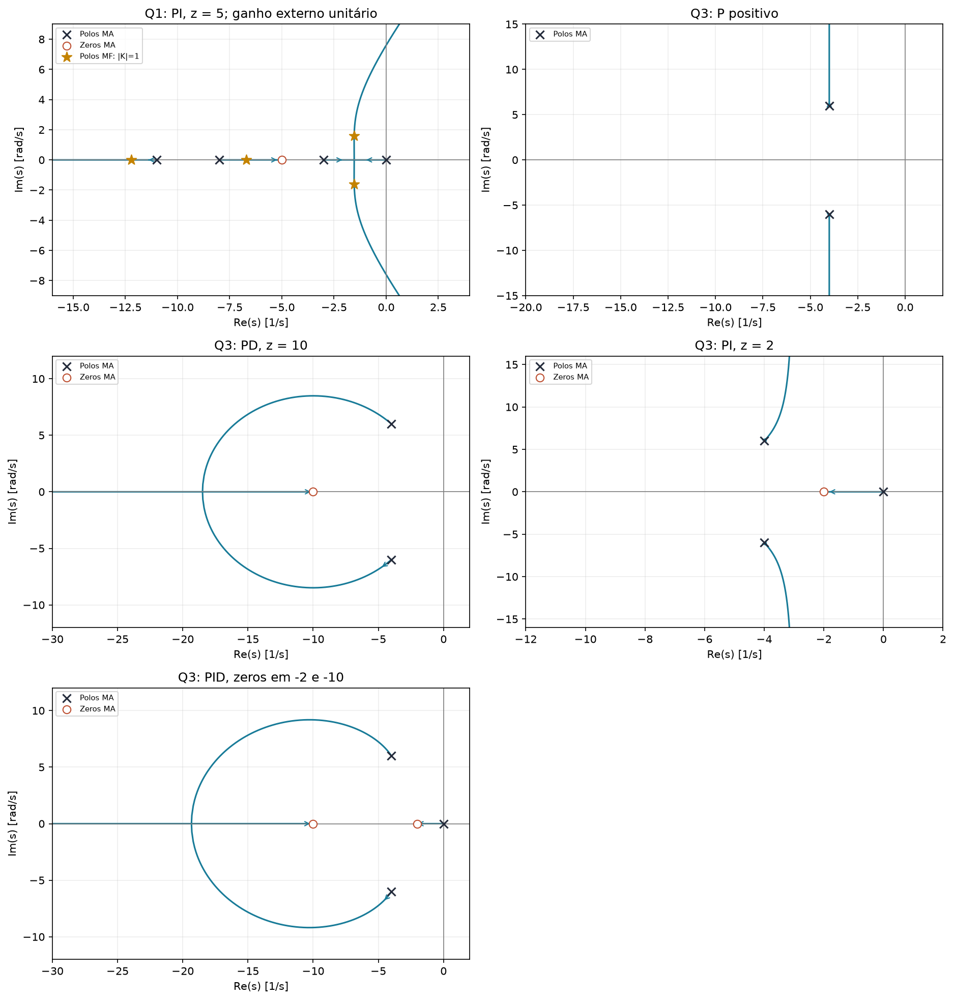
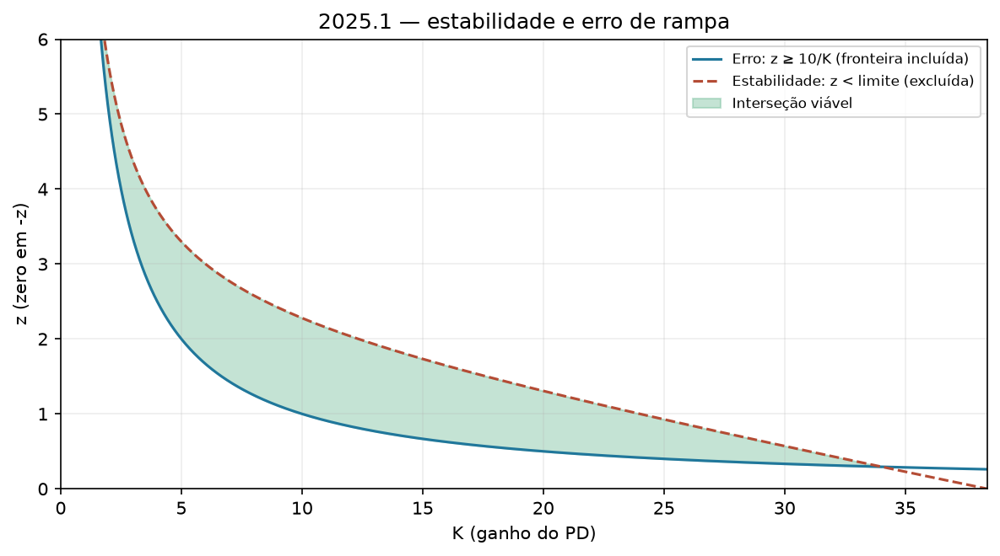

# 2025.1 — resolução didática

[Voltar ao roteiro](../README.md) · [Enunciado](<EL466 Prova da 2ª Unidade, 2025.1 questoes.pdf>) · [Resolução fornecida](<EL466 Prova da 2ª Unidade, 2025.1 resolucoes.pdf>)

**Aplicação:** 30/07/2025. **Questões:** 3. Use como exercício guiado antes dos simulados mais recentes.

## Questão 1 — PI por refinamento, 3 pontos

$$G=\frac{10}{(s+3)(s+8)(s+11)},\qquad
G_c=K\frac{s+z}{s}.$$

### a) Projetar para Mp = 5% e Ts(2%) = 2,4232 s

**Passo 1 — converter o sobressinal em amortecimento.**

$$\zeta=\frac{-\ln(0,05)}{\sqrt{\pi^2+\ln^2(0,05)}}\approx0,6901.$$

**Passo 2 — converter o tempo em posição no plano.**

A convenção do material é $T_s(2\%)\approx3,716/(\zeta\omega_n)$:

$$\sigma=\zeta\omega_n=3,716/2,4232\approx1,5335.$$

$$\omega_n\approx2,2224,\qquad
s_d=-\sigma+j\omega_n\sqrt{1-\zeta^2}\approx-1,5335+j1,6086.$$

**Passo 3 — regra do ângulo, antes do ganho.**

$$L=\frac{10K(s+z)}{s(s+3)(s+8)(s+11)}.$$

Os ângulos dos vetores dos quatro polos até $s_d$ são aproximadamente:

| Polo | Como calcular |
|---|---|
| 0 | $180^\circ-\arctan(1,6086/1,5335)$ |
| $-3$ | $\arctan[1,6086/(3-1,5335)]$ |
| $-8$ | $\arctan[1,6086/(8-1,5335)]$ |
| $-11$ | $\arctan[1,6086/(11-1,5335)]$ |

A soma é aproximadamente $204,8898^\circ$. Então:

$$\theta_z-204,8898^\circ=-180^\circ
\Rightarrow\theta_z=24,8898^\circ.$$

$$z=1,5335+\frac{1,6086}{\tan24,8898^\circ}\approx5.$$

**Passo 4 — regra do módulo.**

$$K=\frac{|s_d|\,|s_d+3|\,|s_d+8|\,|s_d+11|}
{10|s_d+5|}\approx8,10.$$

$$\boxed{G_c(s)\approx8,10\frac{s+5}{s}.}$$

O gabarito usa $K=8,0998$, após arredondar os polos desejados. Pequenas diferenças no último dígito são normais. A soma de ângulos e o módulo são a resolução pedida; uma simples comparação de coeficientes não substituiria o método exigido.

### b) Esboço, polos de MF e avaliação

- Polos de MA: $0,-3,-8,-11$.
- Zero: $-5$.
- Trechos reais: $(-\infty,-11)$, $(-8,-5)$ e $(-3,0)$.
- Centroide: $(-22+5)/3=-17/3$.
- Assíntotas: $60^\circ,180^\circ,300^\circ$.

Para $K=8,0998,z=5$:

$$\Delta=s^4+22s^3+145s^2+344,998s+404,99.$$

$$p\approx-12,2274;\ -6,7054;\ -1,5336\pm j1,6086.$$

O zero da FTMF é $-5$.

O par desejado aparece, mas a função completa não é o modelo padrão de segunda ordem. A conferência da resposta completa dá:

$$\boxed{M_p\approx5,27\%,\quad T_s(2\%)\approx2,731\ \mathrm{s}.}$$

Logo o projeto atende a alocação aproximada do par, mas não reproduz exatamente o tempo de 2,4232 s.

**Precisão conceitual:** o polo $-12,2274$ está mais de cinco vezes afastado em taxa de decaimento; o polo $-6,7054$ não. É exagerado dizer que “todos os polos são dominantes”. O problema real é que a aproximação que despreza os demais polos e o zero não é suficientemente precisa.

## Questão 2 — PD: estabilidade e erro de rampa ≤ 0,3, 3 pontos

$$G=\frac5{s(s+1)(s+3)(s+5)},\quad G_c=K_d(s+z),\quad K_d,z>0.$$

### Passo 1: erro

$$K_v=\frac{5K_dz}{1\cdot3\cdot5}=\frac{K_dz}{3}.$$

$$e_{ss}=3/(K_dz)\le0,3\Rightarrow
\boxed{z\ge10/K_d.}$$

### Passo 2: estabilidade

$$\Delta=s^4+9s^3+23s^2+(15+5K_d)s+5K_dz.$$

| Linha | Coluna 1 | Coluna 2 | Coluna 3 |
|---|---|---|---|
| $s^4$ | 1 | 23 | $5K_dz$ |
| $s^3$ | 9 | $15+5K_d$ | 0 |
| $s^2$ | $B=(192-5K_d)/9$ | $5K_dz$ | 0 |
| $s^1$ | $[B(15+5K_d)-45K_dz]/B$ | 0 | 0 |
| $s^0$ | $5K_dz$ | 0 | 0 |

$$K_d<38,4,\qquad
(192-5K_d)(15+5K_d)-405K_dz>0.$$

$$\boxed{z<\frac{-25K_d^2+885K_d+2880}{405K_d}.}$$

### Passo 3: interseção e desenho

As fronteiras se encontram se:

$$25K_d^2-885K_d+1170=0.$$

$$\boxed{1,375479<K_d<34,024521,\quad
\frac{10}{K_d}\le z<
\frac{-25K_d^2+885K_d+2880}{405K_d}.}$$

Teste $K_d=10,z=1$: erro 0,3; $B>0$; numerador da linha $s^1$ positivo. A igualdade de erro é permitida.

## Questão 3 — qual controlador permite polos reais?, 4 pontos

$$G=\frac{40}{s^2+8s+52},\qquad p=-4\pm j6.$$

Seguimos a convenção de ganhos positivos do gabarito. No enunciado desta questão o sinal não é explicitado em todas as alternativas; uma observação sobre ganhos negativos aparece ao final.

### a) P versus PD

**P positivo:**

$$\Delta=s^2+8s+52+40K_p.$$

$$p=-4\pm j\sqrt{36+40K_p}.$$

O LGR é vertical, em $\operatorname{Re}s=-4$, com duas assíntotas a $90^\circ$ e $270^\circ$. Para $K_p>0$, os polos permanecem complexos: não se obtém o par real distinto pedido.

**PD:**

$$G_c=K_d(s+z),\qquad
\Delta=s^2+(8+40K_d)s+(52+40K_dz).$$

O zero real em $-z$ deixa apenas uma assíntota a $180^\circ$. Para um zero estável fixo e ganho positivo suficientemente grande, o discriminante fica positivo:

$$(8+40K_d)^2-4(52+40K_dz)>0.$$

Exemplo: $z=10,K_d=1$:

$$\Delta=s^2+48s+452,\qquad
p\approx-35,1355,\;-12,8645.$$

São reais distintos e negativos. **PD permite o comportamento modal sobreamortecido.** Como há zero, “polos reais” não implica automaticamente zero sobressinal na resposta completa.

### b) PI versus PID, acrescentando erro de degrau nulo

Agora é preciso manter um integrador na malha aberta.

**PI:**

$$G_c=K_p(s+z)/s,\qquad
\Delta=s^3+8s^2+(52+40K_p)s+40K_pz.$$

Para $z=2$, o centroide é $(-8+2)/2=-3$ e as assíntotas são verticais. O trecho real é $(-2,0)$.

Há uma prova mais forte que o desenho: se todos os polos fossem reais, a derivada da cúbica precisaria admitir os pontos de separação entre eles. Porém:

$$\Delta'(s)=3s^2+16s+(52+40K_p),$$

cujo discriminante é:

$$256-12(52+40K_p)=-368-480K_p<0.$$

Para $K_p>0$, a cúbica tem apenas uma raiz real e um par complexo. Logo o PI **não permite três polos reais** nessa planta. Para ganho muito pequeno, o polo real lento pode dominar e mascarar as oscilações, ao custo de lentidão.

**PID:**

$$G_c=K_d\frac{(s+2)(s+10)}s.$$

Há três polos de MA, dois zeros reais, uma assíntota a $180^\circ$ e trechos reais $(-\infty,-10)$ e $(-2,0)$. O par complexo pode entrar no eixo real.

Exemplo $K_d=1$:

$$\Delta=s^3+48s^2+532s+800.$$

$$p\approx-32,2930,\;-13,9284,\;-1,7786.$$

Todos são reais negativos; a malha é tipo 1 e tem erro de degrau nulo. Assim, **PID atende à exigência de polos reais e erro nulo**. Verificar ausência estrita de sobressinal exigiria considerar os zeros da FTMF.

### Observação sobre o sinal do P

Se ganhos negativos forem admitidos, a afirmação “P nunca dá polos reais” deixa de valer. Para:

$$-1,3<K_p<-0,9,$$

a quadrática tem dois polos reais negativos. Isso é diferente do LGR positivo adotado no gabarito. Na prova, declare a convenção usada antes de concluir.

## O que tirar desta prova

O projeto por LGR determina polos, mas a resposta depende também dos zeros. Separar essas duas ideias resolve tanto a interpretação da Q1 quanto a discussão conceitual da Q3.
