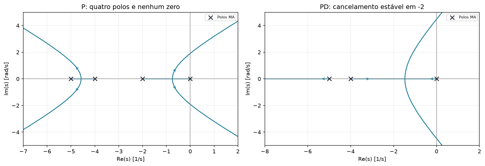
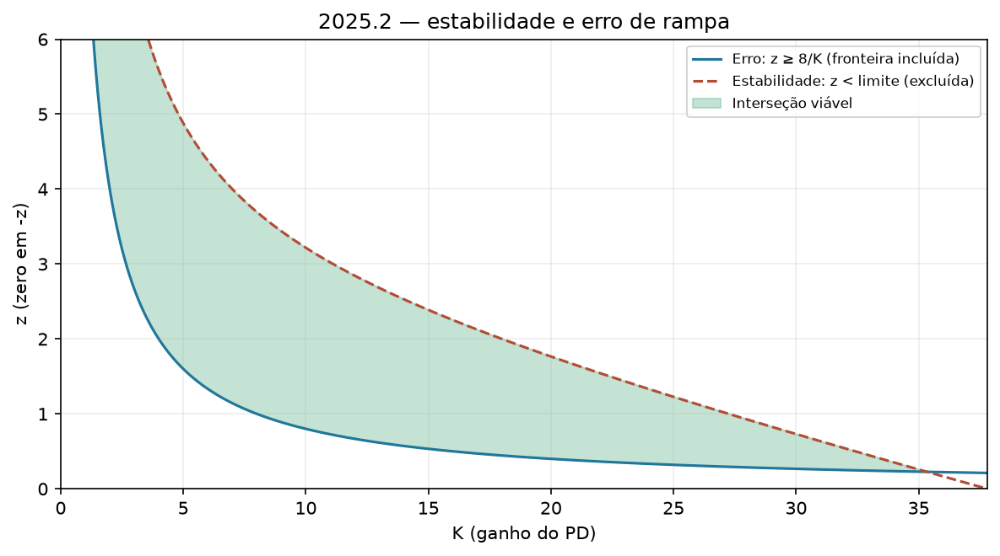
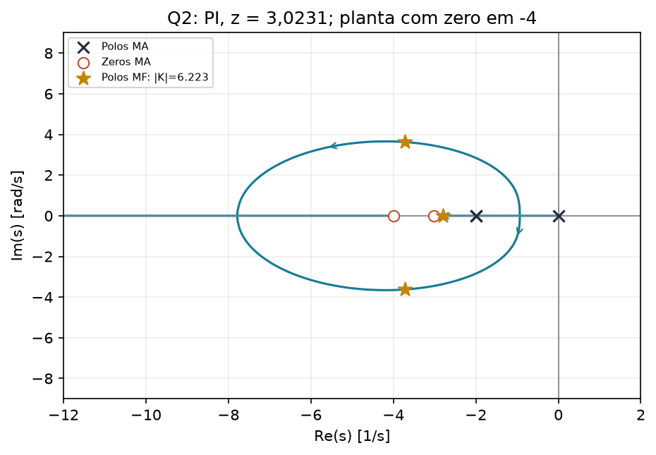

# 2025.2 — resolução didática

[Voltar ao roteiro](../README.md) · [Enunciado](<EL466 Prova da 2ª Unidade, 2025.2 questoes.pdf>) · [Resolução fornecida](<EL466 Prova da 2ª Unidade, 2025.2 resolucoes.pdf>)

**Aplicação:** 19/11/2025. **Questões:** 2. Reserve esta prova para um simulado de 90 minutos, duração sugerida de treino.

## Questão 1 — fresa, 7 pontos

$$G=\frac{10}{s(s+2)(s+4)(s+5)}
=\frac{10}{s^4+11s^3+38s^2+40s}.$$

### a) LGR com P e interpretação do transitório

$$L=\frac{10K}{s(s+2)(s+4)(s+5)}.$$

- Polos em $0,-2,-4,-5$; quatro ramos.
- Trechos reais $(-2,0)$ e $(-5,-4)$.
- Centroide $-11/4=-2,75$.
- Assíntotas a $45^\circ,135^\circ,225^\circ,315^\circ$.

**Ganho pequeno:** um polo fica próximo de zero e domina; resposta aproximadamente de primeira ordem, lenta e sem sobressinal.

**Aumentando o ganho:** o par real lento se aproxima, chega a um encontro crítico e depois vira um par complexo. Inicialmente pode produzir pouco sobressinal e acomodação mais rápida. Perto do eixo imaginário, o amortecimento fica pequeno e o tempo cresce.

**Conferência do ponto crítico:**

$$K(s)=-\frac{s(s+2)(s+4)(s+5)}{10}.$$

$$D'(s)=4s^3+33s^2+76s+40=0.$$

O encontro dominante válido é $s\approx-0,746251$, com $K\approx1,294945$. Pelo formulário:

$$T_s(1\%)\approx6,725/0,746251\approx9,01\ \mathrm{s}.$$

O PDF cita cerca de 8,3 s e um polo aproximado em $-0,7$; esses números não são mutuamente exatos.

**Limite estável, por Routh:**

$$B=\frac{11\cdot38-40}{11}=\frac{378}{11}.$$

$$40B-110K>0\Rightarrow
\boxed{0<K<\frac{15120}{1210}\approx12,495868.}$$

No limite: $s=\pm j\sqrt{40/11}\approx\pm j1,906925$.

Exemplos calculados com a função completa:

| Ganho | $M_p$ | $T_s(1\%)$ |
|---|---|---|
| $K=1,68$ | aproximadamente 0,92% | aproximadamente 5,494 s |
| $K=8$ | aproximadamente 62,33% | aproximadamente 22,323 s |

O gabarito usa tempos aproximados de 5,2 s e 18,5 s. Não confunda estimativas do esboço com medição na resposta completa.

### b) PD: região estável e erro de rampa ≤ 0,5

$$G_c=K(s+z),\quad K,z>0.$$

Erro:

$$K_v=\frac{10Kz}{2\cdot4\cdot5}=\frac{Kz}{4}
\Rightarrow e_{ss}=\frac4{Kz}\le0,5.$$

$$\boxed{z\ge8/K.}$$

Característica:

$$\Delta=s^4+11s^3+38s^2+(40+10K)s+10Kz.$$

| Linha | Coluna 1 | Coluna 2 | Coluna 3 |
|---|---|---|---|
| $s^4$ | 1 | 38 | $10Kz$ |
| $s^3$ | 11 | $40+10K$ | 0 |
| $s^2$ | $B=(378-10K)/11$ | $10Kz$ | 0 |
| $s^1$ | $[B(40+10K)-110Kz]/B$ | 0 | 0 |
| $s^0$ | $10Kz$ | 0 | 0 |

Primeira condição: $K<37,8$.

Segunda:

$$-K^2+33,8K+151,2-12,1Kz>0.$$

Portanto:

$$\boxed{\frac8K\le z<
\frac{-K^2+33,8K+151,2}{12,1K}.}$$

Para existir região:

$$-K^2+33,8K+151,2>96,8
\Rightarrow K^2-33,8K-54,4<0.$$

$$\boxed{0<K<35,339360.}$$

Exemplo: $K=4,z=2$. O produto $Kz=8$ atende ao erro na igualdade e o ponto está dentro da faixa estável.

### c) PD para resposta rápida com sobressinal entre 0% e 1%

A estratégia adotada no gabarito é cancelar o polo lento não nulo em $-2$:

$$z=2,\qquad L_{\rm red}=\frac{10K}{s(s+4)(s+5)}.$$

Centroide $-3$; assíntotas $60^\circ,180^\circ,300^\circ$; trechos reais $(-4,0)$ e $(-\infty,-5)$.

**Primeiro encontre o projeto sem oscilação modal:**

$$K(s)=-\frac{s(s+4)(s+5)}{10},\qquad
3s^2+18s+20=0.$$

O ponto válido é $s=-1,472475$, e:

$$K\approx1,312845.$$

Isso produz par real repetido. O formulário estima $T_s\approx4,567$ s; a resposta cúbica completa reduzida dá aproximadamente **4,694 s**. O valor de 4,16 s citado no PDF não coincide com essa conferência.

**Depois permita um pequeno sobressinal:** aumentar moderadamente $K$ move o par para a região complexa e reduz a acomodação. O exemplo do gabarito:

$$\boxed{z=2,\quad K\approx1,73,\quad G_c\approx1,73(s+2).}$$

Tem polos reduzidos:

$$-6,23868,\quad-1,38066\pm j0,93102.$$

A resposta completa nominal dá:

$$\boxed{M_p\approx0,903\%,\quad T_s(1\%)\approx2,733\ \mathrm{s}.}$$

É um projeto rápido dentro da faixa de sobressinal. A escolha por cancelamento e esboço é a solução aproximada pretendida no material; ela **não demonstra um mínimo global sobre todas as combinações de $K,z$**. Para responder ao estilo da prova, mostre a escolha estratégica, a saída do eixo real e o ganho aproximado.

**Não misture os requisitos das letras:** esse exemplo da letra c tem $Kz=3,46<8$, portanto não satisfaz o erro da letra b. O gabarito trata a letra c como novo projeto de transitório. Se o professor exigir simultaneamente a restrição anterior, o exemplo precisa ser reprojetado.

## Questão 2 — PI por refinamento, 3 pontos

$$G=\frac{s+4}{(s+2)^2},\qquad G_c=K\frac{s+z}{s}.$$

Queremos um par com parâmetros do modelo padrão $M_p=4\%$, $T_s(2\%)=1$ s.

### Passo 1: polo desejado

$$\zeta=\frac{-\ln(0,04)}{\sqrt{\pi^2+\ln^2(0,04)}}\approx0,7156.$$

Usando a convenção do material:

$$\sigma=3,716,\quad\omega_n\approx5,1925,\quad
\boxed{s_d=-3,716+j3,6268.}$$

### Passo 2: ângulo do zero

$$L=\frac{K(s+z)(s+4)}{s(s+2)^2}.$$

Polos de MA: $0,-2,-2$. Zero conhecido: $-4$. Zero desconhecido: $-z$.

$$\theta_z+\theta_{-4}-\theta_0-2\theta_{-2}
=-180^\circ.$$

Os vetores dos polos 0 e $-2$ estão no segundo quadrante. O vetor do zero $-4$ tem parte real $0,284>0$ e está no primeiro. Calculando com esses quadrantes:

$$\theta_z\approx100,8157^\circ.$$

$$z=3,716+\frac{3,6268}{\tan100,8157^\circ}
\approx3,0231.$$

### Passo 3: ganho

$$K=\frac{|s_d|\,|s_d+2|^2}{|s_d+4|\,|s_d+3,0231|}
\approx6,2230.$$

$$\boxed{G_c(s)\approx6,2230\frac{s+3,0231}{s}.}$$

### Passo 4: conferir e interpretar

$$\Delta=s^3+(4+K)s^2+[4+K(z+4)]s+4Kz.$$

Para os valores acima:

$$p\approx-3,7160\pm j3,6268,\quad-2,7910.$$

O par foi alocado. Porém o terceiro polo é mais lento e os zeros em $-3,0231$ e $-4$ também influenciam a resposta.

A conferência da FTMF completa fornece aproximadamente **13,18% de sobressinal** e **0,936 s de acomodação a 2%**. Portanto os parâmetros do par não equivalem a especificações exatas da saída completa. O enunciado pede que surja um par; essa distinção explica por que a solução de refinamento continua correta.

## O que tirar desta prova

- Ganho grande não significa resposta rápida.
- Um zero conhecido da planta entra na condição de ângulo.
- O quadrante do vetor é decisivo.
- Especifique se você está discutindo polos, uma aproximação dominante ou a resposta completa.
