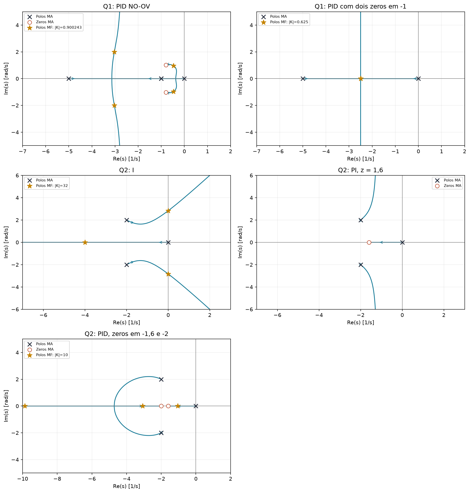
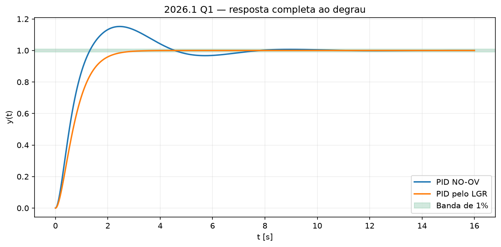

# 2026.1 — resolução didática

[Voltar ao roteiro](../README.md) · [Enunciado](<EL466 Prova da 2ª Unidade, 2026.1 questoes.pdf>) · [Resolução fornecida](<EL466 Prova da 2ª Unidade, 2026.1 resolucoes.pdf>) · [Gabarito manuscrito do monitor](<Gabarito 2EE.pdf>)

**Aplicação:** 27/05/2026. **Questões:** 2. É a prova mais recente do conjunto e deve ser o último simulado.

O manuscrito Gabarito 2EE contém as mesmas duas questões. Na Q2 ele escolhe zero do PI em $-1$; a resolução digitada escolhe $-1,6$. As duas escolhas são válidas e estão relacionadas abaixo.

## Questão 1 — comparar NO-OV com projeto pelo LGR, 6 pontos

$$G(s)=\frac{10}{(s+1)^2(s+5)}.$$

### a) Sintonia NO-OV

**Passo 1: use P puro para encontrar a oscilação crítica.**

$$\Delta=(s+1)^2(s+5)+10K
=s^3+7s^2+11s+5+10K.$$

| Linha | Coluna 1 | Coluna 2 |
|---|---|---|
| $s^3$ | 1 | 11 |
| $s^2$ | 7 | $5+10K$ |
| $s^1$ | $(72-10K)/7$ | 0 |
| $s^0$ | $5+10K$ | 0 |

$$K_{cr}=7,2.$$

**Passo 2: obtenha a frequência pela linha acima.**

$$A(s)=7s^2+77=0\Rightarrow
\omega_{cr}=\sqrt{11}\approx3,316625.$$

$$P_{cr}=2\pi/\sqrt{11}\approx1,894452\ \mathrm{s}.$$

**Passo 3: aplique a tabela NO-OV do enunciado.**

$$K_p=0,20K_{cr}=1,44,$$

$$T_i=0,50P_{cr}\approx0,947226,\quad
T_d=0,33P_{cr}\approx0,625169.$$

$$K_i=K_p/T_i\approx1,520229,\quad
K_d=K_pT_d\approx0,900243.$$

$$\boxed{G_c(s)\approx1,44+\frac{1,520229}{s}+0,900243s.}$$

A ação integral torna a malha tipo 1 e possibilita erro nulo de degrau. A palavra NO-OV é o nome de uma sintonia heurística; o transitório precisa ser verificado.

### b) Fatorar, desenhar e interpretar

$$G_c=0,900243\,
\frac{s^2+(1,44/0,900243)s+1,520229/0,900243}{s}.$$

Os zeros são aproximadamente:

$$-0,7998\pm j1,0241.$$

Com os arredondamentos do PDF:

$$G_c\approx0,9\frac{(s+0,8+j1,024)(s+0,8-j1,024)}s.$$

Troque **0,9**, o ganho da forma fatorada, por $K$:

$$L=\frac{10K(s^2+1,6s+1,6887)}{s(s+1)^2(s+5)}.$$

- Polos de MA: $0,-1,-1,-5$; quatro ramos.
- Zeros de MA: $-0,8\pm j1,024$.
- Trechos reais: $(-5,-1)$ e $(-1,0)$; o polo duplo precisa ser contado duas vezes.
- Duas assíntotas: $90^\circ$ e $270^\circ$.
- Centroide: $[-7-(-1,6)]/2=-2,7$.

**Para o ganho efetivamente calculado**, os polos da malha são aproximadamente:

$$-0,472\pm j0,967,\qquad -3,028\pm j1,99.$$

O par perto do eixo imaginário domina a duração do transitório. A resposta completa tem aproximadamente:

$$\boxed{M_p\approx15,2\%,\quad T_s(1\%)\approx7,2\ \mathrm{s}.}$$

Há oscilação e o sistema é relativamente lento. Não é correto concluir que $K\approx0,9$ é “pequeno” e presumir quatro polos reais sem conferir sua posição no LGR.

### c) PID pelo LGR para acelerar sem oscilação

Os polos lentos da planta são os dois polos em $-1$. Aloque ali os dois zeros:

$$G_c=K\frac{(s+1)^2}{s}.$$

A malha nominal reduzida fica:

$$L_{\rm red}=\frac{10K}{s(s+5)},\qquad
T_{\rm red}=\frac{10K}{s^2+5s+10K}.$$

O LGR vai dos polos 0 e $-5$ até o encontro em $-2,5$, depois sobe e desce verticalmente. Para obter o encontro crítico:

$$s^2+5s+10K=(s+2,5)^2.$$

$$10K=6,25\Rightarrow\boxed{K=0,625.}$$

$$\boxed{G_c(s)=0,625\frac{(s+1)^2}{s}
=0,625s+1,25+\frac{0,625}{s}.}$$

Como o modelo reduzido é uma segunda ordem crítica sem zeros:

$$M_p=0,\quad y(t)=1-(1+2,5t)e^{-2,5t}.$$

$$T_s(1\%)\approx2,655\ \mathrm{s}\quad\text{pelo modelo exato},$$

ou $6,725/2,5=2,690$ s usando a aproximação do formulário. O valor 2,66 s do gabarito é consistente com a resposta exata.

| Projeto | Sobressinal | Acomodação de 1% |
|---|---|---|
| NO-OV | aproximadamente 15,2% | aproximadamente 7,2 s |
| PID por cancelamento nominal | 0 | aproximadamente 2,66 s |

Os dois modos cancelados em $-1$ continuam estáveis. Para o modelo nominal e resposta à referência com condições iniciais nulas, a redução é exata; incertezas de planta podem prejudicar o cancelamento.

## Questão 2 — I, PI e PID para uma planta oscilatória, 4 pontos

$$G=\frac1{s^2+4s+8},\qquad p=-2\pm j2.$$

### a) Comparar I e PI pelo LGR

**I:**

$$G_c=K/s,\quad L=\frac K{s(s^2+4s+8)}.$$

Polos de MA: $0,-2\pm j2$. Nenhum zero finito. Centroide $-4/3$; assíntotas $60^\circ,180^\circ,300^\circ$. Trecho real: $(-\infty,0)$.

Os ramos complexos acabam entrando no semiplano direito para ganho alto. Para ganho muito baixo, o polo real próximo da origem domina e a resposta pode parecer pouco oscilatória, mas é lenta.

**PI:**

$$G_c=K(s+z)/s,\quad L=\frac{K(s+z)}{s(s^2+4s+8)}.$$

Há um zero em $-z$ e duas assíntotas verticais:

$$\sigma_a=\frac{-4+z}2.$$

Uma escolha simples é $z=1,6$, como na resolução digitada:

$$\sigma_a=-1,2,\quad\text{trecho real }(-1,6,0).$$

O manuscrito usa $z=1$, que dá centroide $-1,5$. Ambos ampliam a faixa estável, como Routh comprova abaixo.

**Eles podem dar todos os polos reais?**

Para PI:

$$\Delta=s^3+4s^2+(8+K)s+Kz.$$

Sua derivada tem discriminante:

$$8^2-12(8+K)=-32-12K<0.$$

A cúbica tem somente uma raiz real para $K>0$. Com I, o mesmo raciocínio vale substituindo $8+K$ por 8. Portanto nenhum dos dois permite os três polos reais. Pode haver aproximação por um polo real lento, mas isso não remove o par complexo.

### b) Demonstrar a ampliação de estabilidade

**I:**

$$\Delta=s^3+4s^2+8s+K.$$

| Linha | Coluna 1 | Coluna 2 |
|---|---|---|
| $s^3$ | 1 | 8 |
| $s^2$ | 4 | $K$ |
| $s^1$ | $(32-K)/4$ | 0 |
| $s^0$ | $K$ | 0 |

$$\boxed{0<K<32.}$$

No limite $K=32$: $\Delta=(s+4)(s^2+8)$ e $\omega=\sqrt8$.

**PI:**

$$\Delta=s^3+4s^2+(8+K)s+Kz.$$

Primeira coluna:

$$1,\quad4,\quad\frac{32+(4-z)K}{4},\quad Kz.$$

Para $z=1,6$:

$$32+2,4K>0,\quad1,6K>0,$$

o que vale para todo $K>0$.

$$\boxed{\text{PI com }z=1,6:\quad 0<K<\infty.}$$

Se usar $z=1$ do manuscrito: a condição é $32+3K>0$, novamente válida para todo $K>0$.

**Faixa geral correta:**

$$
\begin{cases}
0<z\le4: & \text{estável para todo }K>0,\\
z>4: & 0<K<32/(z-4).
\end{cases}
$$

O caso $z=4$ também é estável para cada ganho positivo finito; a assíntota fica no eixo, mas isso não significa cruzamento para ganho finito. A escolha $z<4$ mantém as assíntotas estritamente à esquerda.

### c) Modificar o PI para haver região de polos reais

Adicione um segundo zero real estável. Partindo de $z=1,6$, escolha o segundo zero em $-2$:

$$\boxed{G_c=K\frac{(s+1,6)(s+2)}s.}$$

Esse é um **PID**, com um polo na origem e dois zeros reais. A malha tem uma assíntota a $180^\circ$; os trechos reais são $(-\infty,-2)$ e $(-1,6,0)$. O par complexo pode entrar no eixo real.

Não é necessário calcular $K$, mas podemos conferir a viabilidade com $K=10$:

$$\Delta=s^3+14s^2+44s+32,$$

$$p\approx-9,8709,\;-3,0748,\;-1,0543.$$

São três polos reais negativos. Se você partiu do zero $-1$ do manuscrito, pode seguir a alternativa do monitor:

$$G_c=K(s+1)(s+5)/s.$$

**Nuance:** polos reais removem modos senoidais, mas zeros podem gerar sobressinal não oscilatório. Não prometa monotonicidade apenas pela geometria dos polos.

Se fosse permitido reprojetar os dois zeros, outra opção nominal seria:

$$G_c=K\frac{s^2+4s+8}{s}\Rightarrow T=\frac K{s+K},$$

com resposta de primeira ordem monótona. Isso troca os dois zeros e, portanto, não é a mesma construção de “partir do PI e acrescentar um zero” pedida no item.

## O que tirar desta prova

- Buscar $K_{cr}$ com P e depois projetar o PID.
- Fatorar o numerador mantendo a ordem dos ganhos.
- Conferir NO-OV na malha completa.
- Usar zeros para alterar o número de assíntotas e as possibilidades de polos reais.
- Distinguir “estável para todo ganho” de “bom transitório para todo ganho”.
