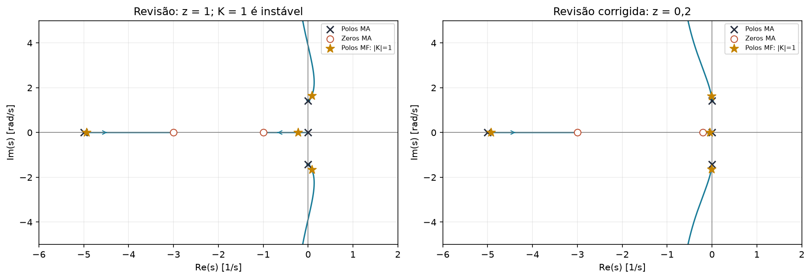

# Exercícios exclusivos da revisão — resolvidos

[Voltar ao início](../README.md) · [PDF de referência](<Revisão 2EE.pdf>) · [Guia das páginas](GUIA_DOS_MATERIAIS.md)

## Extra A — entrada cúbica e região K1 × K2

**Fonte:** revisão pp. 1–2.

$$G=\frac1{s^2(s+10)},\qquad
G_c=\frac{K_1s^2+2K_1s+K_2}{s},\qquad R(s)=1/s^4.$$

### 1. Erro

$$L=\frac{K_1s^2+2K_1s+K_2}{s^3(s+10)}.$$

A malha é tipo 3 se $K_2\ne0$. Para a entrada cúbica normalizada:

$$e_{ss}=\frac1{\lim s^3L}=\frac{10}{K_2}.$$

Exigir $e_{ss}\le1$ dá $K_2\ge10$.

### 2. Estabilidade

$$\Delta=s^4+10s^3+K_1s^2+2K_1s+K_2.$$

| Linha | Coluna 1 | Coluna 2 | Coluna 3 |
|---|---|---|---|
| $s^4$ | 1 | $K_1$ | $K_2$ |
| $s^3$ | 10 | $2K_1$ | 0 |
| $s^2$ | $0,8K_1$ | $K_2$ | 0 |
| $s^1$ | $2K_1-12,5K_2/K_1$ | 0 | 0 |
| $s^0$ | $K_2$ | 0 | 0 |

Logo $K_1>0$, $K_2>0$ e $K_2<0,16K_1^2$.

### 3. Interseção

$$\boxed{K_1>7,905694,\quad 10\le K_2<0,16K_1^2.}$$

Desenhe $K_1$ na horizontal, $K_2$ na vertical, a reta horizontal $K_2=10$ incluída e a parábola $K_2=0,16K_1^2$ excluída. Hachure a faixa entre elas, à direita da interseção. Exemplo válido: $K_1=10,K_2=12$.

## Extra B — estabilizar polos no eixo imaginário com PD

**Fonte:** revisão pp. 3–4.

$$G=\frac{s+3}{s(s^2+2)(s+5)}.$$

### a) P não estabiliza para ganho positivo

Com $G_c=K$:

$$\Delta=s^4+5s^3+2s^2+(10+K)s+3K.$$

Polos de MA: $0,\pm j\sqrt2,-5$. Zero $-3$. Centroide $(-5+3)/3=-2/3$, assíntotas $60^\circ,180^\circ,300^\circ$. Trechos reais $(-\infty,-5)$ e $(-3,0)$.

Para conferir o sentido inicial do polo $p=j\sqrt2$, use:

$$\frac{ds}{dK}\bigg|_{K=0}=-\frac{N(p)}{D'(p)}
=\frac{p+3}{4(p+5)}.$$

A parte real é $17/108>0$: o polo entra no semiplano direito. Além disso, não há cruzamento posterior para o lado estável: em $s=j\omega$, a parte imaginária impõe $\omega^2=2+K/5$; substituída na parte real, resulta $K(3,4+0,04K)=0$, sem solução positiva.

Assim o LGR positivo não possui faixa estável. Routh confirma imediatamente $B=[10-(10+K)]/5=-K/5<0$. Em $K=0$ a malha tampouco é estritamente estável.

### b) Escolher um zero de PD — correção do exemplo manuscrito

O monitor escolhe $z=1$ e usa o centroide negativo como justificativa. Isso **não garante estabilidade para todo ganho**. Para essa escolha:

$$\Delta=s^4+5s^3+(2+K_d)s^2+(10+4K_d)s+3K_d.$$

Routh dá $B=K_d/5$ e a condição seguinte é $K_d(0,8K_d-13)>0$. Portanto, com $z=1$, a faixa correta é **$K_d>16,25$**, e não todo ganho positivo.

Para resolver o requisito de todo $K_d>0$, escolha **$z=0,2$**:

$$L=\frac{K_d(s+0,2)(s+3)}{s(s^2+2)(s+5)}.$$

Há duas assíntotas verticais com centroide $(-5+0,2+3)/2=-0,9$; trechos reais $(-5,-3)$ e $(-0,2,0)$.

Vamos justificar a trajetória, sem usar Routh como método principal. No polo $p=j\sqrt2$:

$$\frac{ds}{dK_d}\bigg|_0=\frac{(p+z)(p+3)}{4(p+5)},\qquad
\operatorname{Re}\frac{ds}{dK_d}=\frac{17z-4}{108}.$$

Com $z=0,2$, a parte real é negativa. O polo na origem também entra à esquerda, pois sua sensibilidade é $-3z/10<0$; o polo em $-5$ começa estável.

Para excluir cruzamentos posteriores, use:

$$\Delta=s^4+5s^3+(2+K_d)s^2+[10+(3+z)K_d]s+3zK_d.$$

Em $s=j\omega$ com $\omega\ne0$, a parte imaginária fornece

$$\omega^2=2+\frac{3+z}{5}K_d.$$

Substituindo na parte real:

$$\frac{K_d}{25}\left[5(17z-4)+(z+3)(z-2)K_d\right]=0.$$

Para $z=0,2$, ambos os termos entre colchetes são negativos para ganho positivo. Não há cruzamento do eixo imaginário; tampouco pela origem, pois o termo constante é $3zK_d>0$. O LGR permanece à esquerda.

**Conferência adicional por Routh:** para $0<z<2$, a última condição relevante é

$$4-17z+\frac{(2-z)(z+3)}5K_d>0.$$

Assim, **$0<z\le4/17$** garante estabilidade para todo $K_d>0$. Escolhemos 0,2 dentro dessa faixa.

### c) Impor erro de rampa 0,1

$$K_v=\lim sL=\frac{3K_dz}{10}.$$

Com o zero corrigido $z=0,2$:

$$\frac{10}{3K_d(0,2)}=0,1
\Rightarrow\boxed{K_d=\frac{500}{3}\approx166,6667,\quad
G_c=\frac{500}{3}(s+0,2).}$$

Se você seguir o zero $z=1$ do manuscrito, obtém $K_d=100/3$. Esse ponto específico é estável porque supera 16,25 e tem o erro pedido, mas a afirmação da letra b sobre **todo ganho** continua incorreta.

**Cuidado:** o enunciado recortado usa $K_d\ge0$, mas $K_d=0$ não dá estabilidade estrita. Use $K_d>0$.

## Extra C — descobrir o PID a partir dos LGRs

**Fonte:** revisão pp. 5–6.

No primeiro desenho, a planta tem polos $-1,-2,-4$, sem zeros, e $G(0)=0,5$:

$$G=\frac{A}{(s+1)(s+2)(s+4)},\quad A/8=0,5\Rightarrow A=4.$$

No segundo, surgiu polo na origem e zeros em $-1,-2$. Logo:

$$G_c=K\frac{(s+1)(s+2)}s.$$

É um PID, e a malha reduzida é $L=4K/[s(s+4)]$.

Para o polo marcado $s_d=-2+j1,6062$:

$$K=\frac{|s_d(s_d+4)|}{4}
=\frac{4+1,6062^2}{4}\approx1,64497.$$

$$\omega_n=\sqrt{4K}\approx2,5651,\quad
\zeta=2/\omega_n\approx0,7797.$$

$$M_p\approx2,000\%,\qquad
T_s(2\%)\approx3,716/2=1,858\ \mathrm{s}.$$

Resposta:

$$\boxed{G_c\approx1,64497\frac{(s+1)(s+2)}s.}$$

A escolha encosta o sobressinal na banda de 2%; esse é o raciocínio de rapidez usado no material, com sua aproximação de tempo.

## Extra D — comparar ZN, SO-OV e NO-OV

**Fonte:** revisão pp. 7–10.

$$G=\frac{10}{(s+1)(s+2)(s+3)},\qquad G(0)=5/3.$$

### a) Qual tem menor erro para rampa At?

$$e_{ss}=\frac{A}{G(0)K_i}=\frac{3A T_i}{5K_p}.$$

As três tabelas têm $T_i=P_{cr}/2$; ZN clássico tem o maior $K_p$, portanto menor erro de rampa, após confirmar estabilidade da malha final.

### b) Sintonia ZN

Com P:

$$\Delta=s^3+6s^2+11s+6+10K.$$

$$6\cdot11=6+10K_{cr}\Rightarrow K_{cr}=6.$$

$$A(s)=6s^2+66\Rightarrow
P_{cr}=2\pi/\sqrt{11}\approx1,894452.$$

$$K_p=3,6,\quad T_i=0,947226,\quad T_d=0,236807.$$

$$\boxed{K_i\approx3,800572,\quad K_d\approx0,852502.}$$

### c) Fixar Ti,Td e deixar Kp variável

$$G_c=K_pT_d\,\frac{s^2+(1/T_d)s+1/(T_iT_d)}s.$$

Com ZN clássico exato, $T_i=4T_d$. O discriminante é **zero**:

$$G_c=K_pT_d\frac{(s+4/P_{cr})^2}{s}.$$

Há um **zero duplo em aproximadamente $-2,11143$**.

A p. 10 apresenta dois zeros separados, aproximadamente $-1,9996$ e $-2,2236$. Essa separação resulta de cálculo/arredondamento intermediário inconsistente com a relação exata $T_i=4T_d$; não precisa ser memorizada.

A malha tem polos $0,-1,-2,-3$, zero duplo $-2,11143$, centroide aproximadamente $-0,88857$ e duas assíntotas verticais.

Trechos reais: $(-3,-2,11143)$, $(-2,11143,-2)$ e $(-1,0)$. O zero duplo divide a anotação do segmento, mas o trecho entre $-3$ e $-2$ pertence ao LGR dos dois lados dele.

Para ganho pequeno pode haver aproximação de primeira ordem; depois há possibilidade de pares reais e complexos. O zero duplo pode modificar o sobressinal: não conclua $M_p=0$ apenas por polos reais.

## Extra E — ZN em malha aberta e fechada

**Fonte:** revisão pp. 12–15.

Planta sem zeros, polos $-1,-3,-5$ e ganho estático unitário:

$$G=\frac{15}{(s+1)(s+3)(s+5)}.$$

### a) Malha aberta, usando a leitura gráfica do monitor

$$L\approx0,3,\quad T\approx1,95,\quad R=1/T\approx0,51282.$$

$$K_p=\frac{1,2}{RL}\approx7,8,\quad T_i=0,6,\quad T_d=0,15.$$

$$\boxed{K_p\approx7,8,\quad K_i\approx13,\quad K_d\approx1,17.}$$

Os valores são aproximados porque $L,R$ foram lidos de uma tangente desenhada. Se a tangente for traçada em outra posição, os ganhos mudam.

### b) Malha fechada

$$\Delta=s^3+9s^2+23s+15+15K.$$

$$9\cdot23=15+15K_{cr}
\Rightarrow K_{cr}=12,8.$$

$$\omega_{cr}=\sqrt{23},\quad P_{cr}=2\pi/\sqrt{23}\approx1,310135.$$

$$K_p=7,68,\quad T_i=0,655067,\quad T_d=0,163767.$$

$$\boxed{K_i\approx11,723985,\quad K_d\approx1,257729.}$$

### c) Os métodos são equivalentes?

Eles dão ganhos numericamente próximos neste exemplo. Porém **não são métodos matematicamente equivalentes**: usam informações e aproximações diferentes e não precisam produzir os mesmos ganhos. A frase do manuscrito “são equivalentes” deve ser entendida apenas como proximidade neste caso.

### d) Qual tem menor erro de rampa?

Como $G(0)=1$, $e_{ss}=1/K_i$:

$$e_{\rm MA}\approx1/13=0,076923,\quad
e_{\rm MF}\approx1/11,723985=0,085295.$$

O PI/PID obtido pela leitura de malha aberta tem menor erro de rampa neste exemplo. Ambos os controladores finais são estáveis pelas condições da quártica; comparar $K_i$ faz sentido aqui.

## Extra F — implementação do controlador

**Fonte:** revisão p. 16.

O numerador correto é $K_ds^2+K_ps+K_i$. Há uma troca de coeficientes e uma expressão de estágio filtrado que requer correção no manuscrito.

Veja a dedução dos estágios, a alternativa ideal com dois amplificadores e os componentes calculados em [PID com amplificadores](../Assuntos/09_PID_com_amplificadores.md). Use a função de transferência para conferir o circuito, não apenas os valores anotados.
