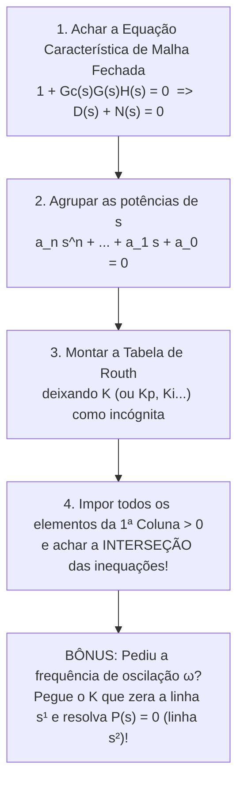

# Guia Didático Completo — Tema 5: Estabilidade de Sistemas de Controle e Critério de Routh-Hurwitz

> **Disciplina:** Engenharia de Controle 2 (EL466 — UFPE/CTG/DEE)  
> **Baseado nos slides de:** Prof. Fabrício Bradaschia ([Tema_5_Estabilidade_Sistemas_Controle.pdf](file:///home/luan/Projetos/UFPE/Controle2/2/Tema_5_Estabilidade_Sistemas_Controle.pdf)) e na [Lista 4](file:///home/luan/Projetos/UFPE/Controle2/2/EL466%20Lista%204%20Estabilidade%20e%20Criterio%20de%20Routh-Hurwitz%20questoes.pdf).

---

## Sumário
1. [Conceito de Estabilidade: A Intuição Física e Matemática (Slides 3 a 14)](#1-conceito-de-estabilidade-a-intuição-física-e-matemática-slides-3-a-14)
2. [Onde Olhar? Os Polos no Plano $s$ e Classificação (Slides 10 a 15)](#2-onde-olhar-os-polos-no-plano-s-e-classificação-slides-10-a-15)
3. [Por que Precisamos de Routh-Hurwitz? E o "Filtro Rápido" (Slides 16 a 25)](#3-por-que-precisamos-de-routh-hurwitz-e-o-filtro-rápido-slides-16-a-25)
4. [O Algoritmo de Routh-Hurwitz: Passo a Passo do Caso Padrão (Slides 26 a 37)](#4-o-algoritmo-de-routh-hurwitz-passo-a-passo-do-caso-padrão-slides-26-a-37)
5. [Os 4 Casos Especiais da Tabela de Routh (Slides 38 a 59)](#5-os-4-casos-especiais-da-tabela-de-routh-slides-38-a-59)
6. [Estabilidade Relativa e Deslocamento de Eixo no Plano $s$ (Slides 61 a 67)](#6-estabilidade-relativa-e-deslocamento-de-eixo-no-plano-s-slides-61-a-67)
7. [Análise Paramétrica e Projeto de Controladores com Routh (Slides 68 a 78)](#7-análise-paramétrica-e-projeto-de-controladores-com-routh-slides-68-a-78)
8. [Comandos Úteis do MATLAB (Slide 60)](#8-comandos-úteis-do-matlab-slide-60)
9. [Resumo de Ouro (Cola Mental para a Prova)](#9-resumo-de-ouro-cola-mental-para-a-prova)

---

## 1. Conceito de Estabilidade: A Intuição Física e Matemática (Slides 3 a 14)

### 1.1. Por que estabilidade é o requisito nº 1 em Controle?
Antes de se preocupar se um sistema é rápido (resposta transitória) ou preciso (erro em regime permanente), ele **precisa ser estável**. Um sistema de controle em malha fechada instável não tem utilidade prática — sua saída cresce sem controle até saturar atuadores, desarmar proteções ou destruir fisicamente a planta.

* **Plantas inerentemente instáveis:** Existem sistemas que, sozinhos (sem controle), "caem" ou divergem naturalmente. Exemplos clássicos: um **avião de caça moderno**, um **foguete na decolagem** ou um **pêndulo invertido** (Questão 9 da Lista 4). Esses sistemas **nunca** podem ser estabilizados em malha aberta; eles **exigem realimentação (malha fechada)** para estabilizar a planta.
* **Plantas inerentemente estáveis:** Podem até operar em malha aberta sem divergir, mas usamos realimentação para melhorar erro estacionário, rejeitar perturbações e acelerar a resposta transitória. **Porém, cuidado:** colocar um ganho alto demais na realimentação pode transformar uma planta estável em um sistema em malha fechada **instável**!

---

### 1.2. Estabilidade Absoluta vs. Estabilidade Relativa (Slides 4 e 5)

| Conceito | Pergunta que responde | Exemplo Prático (Aviação — Slide 5) |
| :--- | :--- | :--- |
| **Estabilidade Absoluta** | *"O sistema é estável ou instável?"* (É binário: SIM ou NÃO). | Tanto um avião comercial quanto um caça precisam ser absolutamente estáveis (com o controle ligado) para não caírem. |
| **Estabilidade Relativa** | *"Assumindo que é estável, **quão** estável ele é? Quão longe da fronteira da instabilidade ele está?"* | **Avião comercial:** projetado para ter **alta estabilidade relativa** (muito amortecido, longe da instabilidade $\to$ voo suave, mas difícil de fazer manobras bruscas).<br>**Caça militar:** projetado para ser absolutamente estável, mas **próximo da instabilidade** (baixa estabilidade relativa $\to$ permite ao piloto fazer manobras extremamente rápidas e ágeis). |

---

### 1.3. As Duas Definições Formais de Estabilidade (Slides 6 a 9)

Para sistemas **Lineares e Invariantes no Tempo (LIT)**, analisamos a estabilidade sob duas óticas equivalentes:

#### A) Estabilidade BIBO (*Bounded-Input, Bounded-Output* — Entrada Limitada, Saída Limitada)
> **Definição (Slide 6):** Um sistema LIT é **BIBO estável** se, para **toda** entrada limitada em magnitude ($|r(t)| \le M < \infty$), a saída também for limitada em magnitude ($|y(t)| \le N < \infty$).

Pela integral de convolução da saída com a resposta ao impulso $g(t)$:
$$y(t) = \int_0^\infty r(t - \tau)\,g(\tau)\,d\tau$$

Para que $|y(t)| \le N < \infty$, a condição necessária e suficiente sobre a resposta ao impulso $g(t)$ é que sua área absoluta seja finita:
$$\int_0^\infty |g(\tau)|\,d\tau \le Q < \infty$$

* **Por que um polo no lado direito do plano $s$ destrói a estabilidade BIBO? (Slide 7):**
  Se o sistema tem um polo $p_1 = \sigma_1 \ge 0$ (no semiplano direito ou origem), sua resposta ao impulso $g(t)$ contém termos que não decaem (como $e^{\sigma_1 t}$ com $\sigma_1 \ge 0$). Isso faz com que $\int_0^\infty |g(t)|\,dt = \infty$, violando a condição BIBO!

#### B) Estabilidade Assintótica (Entrada Nula, Condições Iniciais Não Nulas — Slides 8 e 9)
Imagine que a entrada é zero ($r(t) = 0$), mas você tira o sistema do repouso dando um "empurrãozinho" (condições iniciais não nulas). O sistema é **assintoticamente estável** se:
1. A saída permanece limitada: $|y(t)| \le M < \infty$; **e**
2. A saída retorna a zero com o tempo: $\lim_{t \to \infty} |y(t)| = 0$.

#### A Analogia da Bola na Cuba (Slide 9)
Imagine uma bolinha sofrendo uma pequena perturbação:
1. **Estável (Assintoticamente):** Bola no fundo de uma **cuba côncava para cima, com atrito**. Há dissipação de energia, as oscilações diminuem e a bola **volta ao ponto de equilíbrio** ($y(t) \to 0$).
2. **Marginalmente Estável:** Bola sobre uma **mesa plana horizontal sem atrito** (ou numa cuba sem atrito algum). A energia é conservada: a bola não volta ao ponto original (ou fica oscilando com amplitude constante para sempre), mas **não dispara para o infinito**.
3. **Instável:** Bola equilibrada no topo de uma **cúpula (cuba de cabeça para baixo)**. Qualquer sopro faz a perturbação crescer e a bola **se afasta indefinidamente do equilíbrio**.

---

## 2. Onde Olhar? Os Polos no Plano $s$ e Classificação (Slides 10 a 15)

Você **não precisa** calcular a transformada inversa de Laplace $y(t)$ para saber se um sistema LIT é estável! Basta olhar para a **localização dos polos da função de transferência em malha fechada** no plano complexo $s = \sigma + j\omega$:

* Um polo real $p = \sigma$ gera na resposta temporal um termo proporcional a $e^{\sigma t}$:
  * Se $\sigma < 0$ (Lado Esquerdo): $e^{\sigma t} \to 0$ (decai $\to$ **Estável**).
  * Se $\sigma > 0$ (Lado Direito): $e^{\sigma t} \to \infty$ (explode $\to$ **Instável**).
* Um par de polos complexos conjugados $p = \sigma \pm j\omega$ gera $e^{\sigma t}\cos(\omega t + \phi)$:
  * Se $\sigma < 0$ (Lado Esquerdo): senoide amortecida que vai a zero ($\to$ **Estável**).
  * Se $\sigma = 0$ (Sobre o eixo $j\omega$, simples): senoide pura $\cos(\omega t + \phi)$ que oscila com amplitude constante ($\to$ **Marginalmente Estável**).
  * Se $\sigma > 0$ (Lado Direito): senoide crescente que explode ($\to$ **Instável**).

```
                     Plano s (Polos de Malha Fechada)
                              jω (Eixo Imaginário)
                               ▲
         REGIÃO ESTÁVEL        │        REGIÃO INSTÁVEL
     (Semiplano Esquerdo)      │       (Semiplano Direito)
           σ = Re(s) < 0       │          σ = Re(s) > 0
                               │
       Polos aqui: e^(σt)      │      Basta 1 polo aqui para
       decai para zero!        │      o sistema explodir!
   ────────────────────────────┼────────────────────────────► σ
                               │0
                               │  ◄── Polos no eixo jω (σ = 0):
                               │      • Simples (1x): Marginalmente Estável
                               │      • Múltiplos (2x ou +): INSTÁVEL!
```

### Tabela Resumo Oficial (Slide 12 + Ressalva do Slide 11)

| Condição de Estabilidade | Posição dos Polos em Malha Fechada no Plano $s$ |
| :--- | :--- |
| **Absolutamente Estável** | **TODOS** os polos estão estritamente no **lado esquerdo** do plano $s$ ($\text{Re}(s) < 0$). Garante estabilidade BIBO e assintótica. |
| **Marginalmente Estável** *(ou Marginalmente Instável)* | Há **polos simples (não repetidos!)** sobre o eixo $j\omega$ ($\text{Re}(s) = 0$) e **todos os outros** polos estão no lado esquerdo ($\text{Re}(s) < 0$). |
| **Absolutamente Instável** | Há **pelo menos um polo no lado direito** do plano $s$ ($\text{Re}(s) > 0$) **OU** há **polos múltiplos (repetidos) sobre o eixo $j\omega$**. |

> [!CAUTION]
> **Pegadinha Clássica de Prova (Slide 11): Polos Múltiplos no Eixo $j\omega$!**  
> Se o sistema tiver um polo duplo na origem ($s^2$ no denominador, isto é, dois polos em $s = 0$) ou um par duplo em $\pm j\omega$ como $(s^2 + \omega^2)^2$, a resposta temporal ganha um fator $t^n$: $A\,t^n\cos(\omega t + \phi)$. Como $t^n$ cresce para o infinito, **polos repetidos no eixo $j\omega$ tornam o sistema INSTÁVEL (BIBO instável)!**

---

### Exercício Resolvido 1 dos Slides (Slides 13 e 14)
**Enunciado:** Classifique os sistemas abaixo quanto à sua estabilidade:

1. $G(s) = \dfrac{20}{(s+1)(s+2)(s+3)}$
   * **Polos:** $s = -1$, $s = -2$, $s = -3$ (todos no lado esquerdo, $\text{Re}(s) < 0$).
   * **Classificação:** **Estável**.

2. $G(s) = \dfrac{20(s+1)}{(s-1)(s^2+2s+2)}$
   * **Polos:** $s = +1$ e $s = -1 \pm j1$. Basta olhar para $s = +1$ (lado direito!).
   * **Classificação:** **Instável** (por causa do polo em $s = 1$).

3. $G(s) = \dfrac{20(s-1)}{(s+1)(s^2+4)}$
   * **Atenção:** O termo $(s-1)$ no numerador é um **zero** em $s = +1$, não é polo! Zeros no lado direito (sistemas de fase não-mínima) **não** alteram a estabilidade absoluta!
   * **Polos:** $s = -1$ (lado esquerdo) e raízes de $s^2 + 4 = 0 \implies s = \pm j2$ (polos **simples** no eixo $j\omega$).
   * **Classificação:** **Marginalmente estável** (polos simples em $s = \pm j2$).

4. $G(s) = \dfrac{10}{s^3 + 30s^2 + 10s} = \dfrac{10}{s(s^2 + 30s + 10)}$
   * **Polos:** Colocando $s$ em evidência, vemos um polo simples na origem ($s = 0$, que pertence ao eixo $j\omega$) e duas raízes de $s^2 + 30s + 10 = 0$, que são reais negativas (pois todos os coeficientes de $s^2 + 30s + 10$ são positivos).
   * **Classificação:** **Marginalmente estável** (devido ao polo simples em $s = 0$).

---

## 3. Por que Precisamos de Routh-Hurwitz? E o "Filtro Rápido" (Slides 16 a 25)

### 3.1. Por que os polos de Malha Aberta enganam? (Slides 18 a 20)
Olhe o exemplo dos Slides 18 e 19: uma planta com ramo direto $G(s) = \frac{K}{s(s+1)(s+2)}$ em realimentação unitária negativa.
* Os polos de **malha aberta** são $s = 0, -1, -2$ (não mudam com $K$).
* Porém, os polos de **malha fechada** são as raízes de $1 + G(s) = 0 \implies s(s+1)(s+2) + K = s^3 + 3s^2 + 2s + K = 0$:
  * Para **$K = 3$** (Slide 18): Polos de MF em $-2,672$ e $-0,164 \pm j1,047 \implies$ **Sistema Estável!**
  * Para **$K = 7$** (Slide 19): Polos de MF em $-3,087$ e $+0,0434 \pm j1,505 \implies$ **Sistema Instável!** (A saída oscila aumentando de amplitude sem parar!).

Quando temos um polinômio de grau $\ge 3$ na prova (sem MATLAB) ou quando o polinômio tem **incógnitas** ($K, K_p, K_i, K_d, a, T$), não conseguimos achar as raízes no braço. É aí que entra o **Critério de Routh-Hurwitz**: um método 100% algébrico que descobre **quantas raízes estão no lado direito do plano $s$ sem precisar calcular as raízes!**

---

### 3.2. Condição Necessária (O "Filtro Rápido" de Prova — Slides 22 a 25)

Considere o polinômio característico do sistema (onde $a_n, a_{n-1}, \dots, a_0$ são números **reais**):
$$\Delta(s) = a_n s^n + a_{n-1} s^{n-1} + a_{n-2} s^{n-2} + \dots + a_1 s + a_0 = 0$$

Pelas Relações de Girard (Slides 23-24), os coeficientes são formados pelas somas e produtos dos polos. Se todos os polos estiverem no lado esquerdo ($\text{Re}(p_i) < 0$), nenhum coeficiente pode zerar nem trocar de sinal ao expandir $(s - p_1)(s - p_2)\dots(s - p_n)$.

> [!IMPORTANT]
> **Teste da Condição Necessária (Slide 25) — Faça isso em 2 segundos antes de montar qualquer tabela!**  
> Para que um polinômio característico $\Delta(s)$ tenha todas as raízes no semiplano esquerdo (sistema estável), é **NECESSÁRIO** (mas não suficiente para $n \ge 3$) que:
> 1. **Todos os coeficientes sejam não-nulos** (não pode faltar nenhuma potência de $s$, desde $s^n$ até $s^0$); **E**
> 2. **Todos os coeficientes tenham o mesmo sinal** (todos positivos ou todos negativos).

* **Se falhar nesse teste** (ex.: falta um termo como em $s^4 + 2s^3 + 20s + 5 = 0$, onde $a_2 = 0$, ou há um sinal trocado): você **JÁ SABE** que o sistema **NÃO é estável**! (Se a questão só perguntar *"é estável?"*, você já responde **NÃO** na hora! Se a questão perguntar *"quantas raízes estão no semiplano direito?"*, aí você monta a tabela de Routh colocando $0$ no coeficiente ausente).
* **Se passar nesse teste:** para 1ª e 2ª ordem já é suficiente (é estável!). Para **3ª ordem ou superior ($n \ge 3$)**, passar no teste **não garante** estabilidade — você **precisa** montar a Tabela de Routh!

---

## 4. O Algoritmo de Routh-Hurwitz: Passo a Passo do Caso Padrão (Slides 26 a 37)

O **Critério de Routh-Hurwitz** é um teste **necessário e suficiente** realizado em **4 passos**:

### Passo 1: Preencher as duas primeiras linhas ($s^n$ e $s^{n-1}$) em zigue-zague (Slide 26)
Dado $\Delta(s) = a_n s^n + a_{n-1} s^{n-1} + a_{n-2} s^{n-2} + a_{n-3} s^{n-3} + a_{n-4} s^{n-4} + a_{n-5} s^{n-5} + \dots + a_0 = 0$:
* A **1ª linha ($s^n$)** recebe o primeiro coeficiente ($a_n$) e depois vai pulando de 2 em 2 ($a_{n-2}, a_{n-4}, \dots$).
* A **2ª linha ($s^{n-1}$)** recebe o segundo coeficiente ($a_{n-1}$) e vai pulando de 2 em 2 ($a_{n-3}, a_{n-5}, \dots$).

$$\begin{array}{c|cccc}
s^n & a_n & a_{n-2} & a_{n-4} & \dots \\
s^{n-1} & a_{n-1} & a_{n-3} & a_{n-5} & \dots
\end{array}$$

### Passo 2 e 3: Calcular as linhas seguintes até $s^0$ (Slides 27 a 29)
A tabela tem $n + 1$ linhas (de $s^n$ até $s^0$):

$$\begin{array}{c|cccc}
s^n & a_n & a_{n-2} & a_{n-4} & \dots \\
s^{n-1} & a_{n-1} & a_{n-3} & a_{n-5} & \dots \\
s^{n-2} & b_1 & b_2 & b_3 & \dots \\
s^{n-3} & c_1 & c_2 & c_3 & \dots \\
\vdots & \vdots & \vdots & \vdots & \ddots \\
s^0 & h_1 & 0 & 0 & \dots
\end{array}$$

**Como calcular cada elemento sem nunca errar o sinal?**
Para calcular a linha $b$ (usando as duas linhas imediatamente acima, onde o **pivô** é o primeiro elemento da linha logo acima, $a_{n-1}$):

$$b_1 = -\frac{\begin{vmatrix} a_n & a_{n-2} \\ a_{n-1} & a_{n-3} \end{vmatrix}}{a_{n-1}} = \frac{a_{n-1} a_{n-2} - a_n a_{n-3}}{a_{n-1}}$$

$$b_2 = -\frac{\begin{vmatrix} a_n & a_{n-4} \\ a_{n-1} & a_{n-5} \end{vmatrix}}{a_{n-1}} = \frac{a_{n-1} a_{n-4} - a_n a_{n-5}}{a_{n-1}}$$

Para a linha $c$, o novo **pivô** passa a ser $b_1$:

$$c_1 = -\frac{\begin{vmatrix} a_{n-1} & a_{n-3} \\ b_1 & b_2 \end{vmatrix}}{b_1} = \frac{b_1 a_{n-3} - a_{n-1} b_2}{b_1}, \qquad c_2 = -\frac{\begin{vmatrix} a_{n-1} & a_{n-5} \\ b_1 & b_3 \end{vmatrix}}{b_1} = \frac{b_1 a_{n-5} - a_{n-1} b_3}{b_1}$$

> [!TIP]
> **Dois Macetes de Ouro para Fazer Contas Rápidas na Prova:**
> 1. **Regra do "Pivô vezes Cima-Direita menos Cruzado":** Como há um sinal de menos na frente do determinante $2 \times 2$, comece sempre multiplicando **o pivô pelo elemento de cima à direita**, menos o produto da outra diagonal, tudo dividido pelo pivô!
> 2. **O termo independente $a_0$ sempre "cai direto":** Sempre que você fizer o determinante com a última coluna não-nula (que tem $a_0$ em cima e $0$ embaixo), o resultado dá $\frac{\text{pivô} \cdot a_0 - (\dots)\cdot 0}{\text{pivô}} = a_0$. Por isso, o último elemento na linha $s^0$ (e no fim das linhas pares) é sempre igual ao próprio $a_0$!

### Passo 4: Ler a 1ª Coluna da Tabela (Slide 30)
Olhe **exclusivamente para a 1ª coluna** da tabela ($a_n, a_{n-1}, b_1, c_1, \dots, h_1$):
* **O número de trocas de sinal na 1ª coluna é exatamente igual ao número de polos do sistema no Semiplano Direito ($\text{Re}(s) > 0$)!**
* Para o sistema ser **Absolutamente Estável**, **NÃO pode haver nenhuma troca de sinal** na 1ª coluna (todos os elementos da 1ª coluna devem ser não nulos e ter o mesmo sinal).

---

### Exercício Resolvido 2 dos Slides: Regras Práticas de 2ª e 3ª Ordem (Slides 31 a 33)

#### 1) Sistema de 2ª Ordem: $a_2 s^2 + a_1 s + a_0 = 0$
$$\begin{array}{c|cc}
s^2 & a_2 & a_0 \\
s^1 & a_1 & 0 \\
s^0 & b_1 = a_0 & 0
\end{array}$$
* **Conclusão (Slide 32):** A 1ª coluna é $[a_2, a_1, a_0]$. Para 2ª ordem, basta que $a_2, a_1, a_0$ sejam **todos positivos** (ou todos negativos) para o sistema ser **estável**!

#### 2) Sistema de 3ª Ordem: $a_3 s^3 + a_2 s^2 + a_1 s + a_0 = 0$
$$\begin{array}{c|cc}
s^3 & a_3 & a_1 \\
s^2 & a_2 & a_0 \\
s^1 & b_1 & 0 \\
s^0 & c_1 = a_0 & 0
\end{array}
\qquad \text{onde} \quad b_1 = \frac{a_2 a_1 - a_3 a_0}{a_2}$$

* **Conclusão (Slide 33 — Memorize para ganhar muito tempo na prova!):**
  Assumindo todos os coeficientes positivos ($a_3, a_2, a_1, a_0 > 0$):
  * **Estável:** $b_1 > 0 \iff \mathbf{a_2 a_1 > a_3 a_0}$ (*"O produto dos coeficientes do meio é maior que o produto dos extremos"*).
  * **Marginalmente Estável (1 par de polos em $\pm j\omega$):** $b_1 = 0 \iff \mathbf{a_2 a_1 = a_3 a_0}$.
  * **Instável (2 polos no SPD):** $b_1 < 0 \iff \mathbf{a_2 a_1 < a_3 a_0}$.

* **Exemplo Rápido (Slide 34):** $\Delta(s) = s^3 + s^2 + 2s + 24 = 0$.
  * Produto dos meios: $a_2 a_1 = 1 \cdot 2 = 2$. Produto dos extremos: $a_3 a_0 = 1 \cdot 24 = 24$. Como $2 < 24$, já sabemos que é instável!
  * Pela tabela: $1ª\text{ coluna} = [1, \; 1, \; -22, \; 24]$. Sinais: $+ \to + \to - \to +$ (**2 trocas de sinal** $\implies$ **2 polos no SPD**).

---

### Exercício Resolvido 3 dos Slides: Sistema de 4ª Ordem (Slides 35 e 36)
**Enunciado:** Determine se o sistema $\Delta(s) = 2s^4 + s^3 + 3s^2 + 5s + 10 = 0$ é estável.

1. **Filtro Rápido:** Todos os coeficientes são positivos ($2, 1, 3, 5, 10 > 0$). Precisamos montar a tabela!
2. **Montando as duas primeiras linhas ($s^4$ e $s^3$):**
   * Linha $s^4$: $2, \; 3, \; 10$
   * Linha $s^3$: $1, \; 5, \; 0$
3. **Calculando as linhas $s^2, s^1, s^0$:**
   * Linha $s^2$ (pivô $= 1$):
     $$b_1 = \frac{1 \cdot 3 - 2 \cdot 5}{1} = -7, \qquad b_2 = \frac{1 \cdot 10 - 2 \cdot 0}{1} = 10$$
   * Linha $s^1$ (pivô $= -7$):
     $$c_1 = \frac{(-7) \cdot 5 - 1 \cdot 10}{-7} = \frac{-45}{-7} \approx +6,43$$
   * Linha $s^0$: $d_1 = 10$ (cai direto!).
4. **Tabela Completa:**
   $$\begin{array}{c|ccc}
   s^4 & 2 & 3 & 10 \\
   s^3 & 1 & 5 & 0 \\
   s^2 & -7 & 10 & 0 \\
   s^1 & 6,43 & 0 & 0 \\
   s^0 & 10 & 0 & 0
   \end{array}$$
5. **Análise da 1ª Coluna:** $[+2, \; +1, \; -7, \; +6,43, \; +10]$.
   * De $+1$ para $-7$: **1ª mudança de sinal**.
   * De $-7$ para $+6,43$: **2ª mudança de sinal**.
   * **Conclusão:** Como houve **2 mudanças de sinal**, o sistema é **instável** e possui exatamente **2 polos no semiplano direito**.

*(Nota do Slide 37: Existe também uma tabela de condições fechadas para polinômios normalizados $s^n + bs^{n-1} + \dots + 1 = 0$ até 6ª ordem, mas na prova é sempre mais seguro e rápido montar a Tabela de Routh!)*

---

## 5. Os 4 Casos Especiais da Tabela de Routh (Slides 38 a 59)

O caso padrão ocorre quando nenhum elemento da 1ª coluna zera. Mas e se aparecer um **zero na 1ª coluna**? Como o elemento da 1ª coluna é o **pivô** (denominador) da linha seguinte, dividir por zero trava a tabela! Existem **4 Casos Especiais** nos slides que você precisa dominar:

---

### Caso Especial 1: Zero Isolado na 1ª Coluna (mas outros elementos da linha $\neq 0$) — Slides 38 a 44

**Como identificar:** O primeiro elemento de uma linha dá $0$, mas há pelo menos um outro número diferente de zero na mesma linha (ex.: linha igual a $[0, \; 6, \; 0]$).

Você tem **duas maneiras** de resolver (e a **Questão 3 da Lista 4** pede que você saiba usar **ambas**!):

#### Método 1A: Método do $\epsilon$ (Substituição por $\epsilon \to 0^+$)
1. Substitua o $0$ da 1ª coluna por um número positivo infinitesimal $\epsilon$ ($\epsilon \to 0^+$).
2. Continue calculando o resto da tabela normalmente em função de $\epsilon$.
3. No final, faça $\epsilon \to 0^+$ e olhe apenas os **sinais** ($+$ ou $-$) da 1ª coluna para contar as trocas de sinal!

#### Método 1B: Método dos Polos Recíprocos (Polinômio Recíproco — Slide 39)
Se um sistema tem polos $p_i$, o sistema com polos recíprocos $p'_i = 1/p_i$ tem **exatamente a mesma quantidade de polos no lado direito e esquerdo** (pois inverter um número complexo mantém o sinal da parte real: $\text{Re}(1/p) = \frac{\text{Re}(p)}{|p|^2}$).
1. **Inverta a ordem dos coeficientes** do polinômio característico original ($a_n$ troca com $a_0$, $a_{n-1}$ troca com $a_1$, etc.).
2. Monte a tabela de Routh para esse novo polinômio invertido e conte as trocas de sinal!

> [!TIP]
> **Dica de Simplificação de Linha (Slide 42):** Em qualquer tabela de Routh, você pode **multiplicar ou dividir uma linha inteira por um número POSITIVO** para simplificar frações antes de calcular a linha seguinte! Isso não muda o sinal de ninguém.

#### Exercício Resolvido 4 dos Slides (Slides 40 a 44)
Vamos resolver o 1º sistema do Exercício 4: $\Delta(s) = s^5 + 2s^4 + 2s^3 + 4s^2 + 11s + 10 = 0$.

* **Pelo Método do $\epsilon$ (Slide 41):**
  * Linha $s^5$: $1, \; 2, \; 11$
  * Linha $s^4$: $2, \; 4, \; 10$
  * Linha $s^3$: $b_1 = \frac{2\cdot 2 - 1\cdot 4}{2} = 0 \cong \epsilon$; $\quad b_2 = \frac{2\cdot 11 - 1\cdot 10}{2} = 6$.
  * Linha $s^2$ (pivô $= \epsilon$): $c_1 = \frac{\epsilon \cdot 4 - 2 \cdot 6}{\epsilon} = \frac{4\epsilon - 12}{\epsilon} \approx -\frac{12}{\epsilon}$; $\quad c_2 = 10$.
  * Linha $s^1$ (pivô $= -12/\epsilon$): $d_1 = \frac{(-12/\epsilon)\cdot 6 - \epsilon \cdot 10}{-12/\epsilon} \approx 6$.
  * Linha $s^0$: $e_1 = 10$.
  * **1ª Coluna quando $\epsilon \to 0^+$:** $[+1, \; +2, \; +\epsilon, \; -12/\epsilon, \; +6, \; +10] \implies$ sinais $[+, +, +, -, +, +]$.
  * **Conclusão:** **2 mudanças de sinal** $\implies$ **2 polos no SPD (Sistema Instável)**.

* **Pelo Polinômio Recíproco (Slide 42):**
  * Invertendo a ordem dos coeficientes de $s^5 + 2s^4 + 2s^3 + 4s^2 + 11s + 10$:
    $$\Delta_{\text{rec}}(s) = 10s^5 + 11s^4 + 4s^3 + 2s^2 + 2s + 1 = 0$$
  * Linha $s^5$: $10, \; 4, \; 2$
  * Linha $s^4$: $11, \; 2, \; 1$
  * Linha $s^3$: $b_1 = \frac{11\cdot 4 - 10\cdot 2}{11} = \frac{24}{11}$; $\quad b_2 = \frac{11\cdot 2 - 10\cdot 1}{11} = \frac{12}{11}$.
    *(Simplificando a linha $s^3$: multiplicando por $\frac{11}{12} > 0$, a linha $[24/11, \; 12/11]$ vira $[2, \; 1]$!)*
  * Linha $s^2$ (usando $[11, 2, 1]$ e $[2, 1, 0]$): $c_1 = \frac{2\cdot 2 - 11\cdot 1}{2} = -\frac{7}{2}$; $\quad c_2 = 1$.
    *(Multiplicando a linha $s^2$ por $2 > 0$: vira $[-7, \; 2]$!)*
  * Linha $s^1$ (usando $[2, 1]$ e $[-7, 2]$): $d_1 = \frac{(-7)\cdot 1 - 2\cdot 2}{-7} = \frac{-11}{-7} = +\frac{11}{7} > 0$.
  * Linha $s^0$: $e_1 = 2 > 0$.
  * **1ª Coluna:** $[+10, \; +11, \; +2, \; -7, \; +1, \; +2] \implies$ **2 mudanças de sinal (Instável, 2 polos no SPD)**!

---

### Caso Especial 2: Linha Inteira Igual a Zero (Polos Simétricos) — Slides 45 a 54

**Como identificar:** Todos os elementos de uma linha dão zero (ex.: $[0, \; 0, \; 0]$ ou uma linha que só tem 1 elemento e ele dá $[0]$). Note que uma linha nula **sempre ocorre em uma linha de potência ímpar** ($s^1, s^3, s^5, \dots$).

**O que isso significa fisicamente/matematicamente? (Slides 45 e 47):**
Significa que o polinômio característico possui **polos simétricos em relação à origem ($s = 0$)** do plano $s$! Existem 3 tipos de simetria em relação à origem (Slide 47):
* **Caso A (Reais simétricos):** Um par de polos reais $\pm \sigma$ (um no SPE em $-\sigma$ e outro no SPD em $+\sigma$).
* **Caso B (Imaginários puros conjugados):** Um par de polos no eixo imaginário $\pm j\omega$. *(É o único caso que NÃO gera troca de sinal na tabela!)*
* **Caso C (Complexos quadrantais):** Quatro polos simétricos $\pm \sigma \pm j\omega$ (dois no SPE e dois no SPD).

#### Passo a Passo para Resolver o Caso Especial 2 (Slide 46):
1. **Monte o Polinômio Auxiliar $P(s)$:** Olhe para a **linha imediatamente ACIMA da linha nula** (que sempre será uma linha de potência **par**: $s^2, s^4, s^6, \dots$). Use os coeficientes dessa linha para escrever o polinômio $P(s)$, pulando os expoentes de 2 em 2 até $s^0$.
   * *Importante:* O grau de $P(s)$ diz **exatamente quantos polos simétricos** o sistema possui! E mais: as raízes de $P(s) = 0$ **são exatamente esses polos simétricos**!
2. **Derive $P(s)$ em relação a $s$:** Calcule $\dfrac{dP(s)}{ds}$.
3. **Substitua a linha nula** pelos coeficientes de $\dfrac{dP(s)}{ds}$ e continue calculando a tabela de Routh normalmente até a linha $s^0$.
4. **Contagem Separada dos Polos (Regra de Ouro do Slide 46):**
   * **Polos NÃO-simétricos:** Olhe da 1ª linha ($s^n$) **até a linha de $P(s)$**. O número de trocas de sinal nesse trecho é o número de polos **não-simétricos no SPD**.
   * **Polos SIMÉTRICOS:** Olhe **da linha de $P(s)$ até a última linha ($s^0$)**. O número de trocas de sinal nesse trecho é o número de polos **simétricos no SPD**.
   * Como os polos simétricos têm simetria em relação à origem: se houver $k$ polos simétricos no SPD, há também $k$ polos simétricos no SPE! E se sobrarem polos simétricos (por exemplo, $P(s)$ tem grau 4 e houve $0$ trocas de sinal abaixo de $P(s)$), todos os polos restantes estão **sobre o eixo imaginário $j\omega$**!

#### Exercício Resolvido 5 dos Slides (Slides 48 a 51)
Vamos analisar o 3º sistema do Exercício 5 (Slide 51):
$$\Delta(s) = s^5 + 7s^4 + 6s^3 + 42s^2 + 8s + 56 = 0$$

1. **Iniciando a Tabela:**
   * Linha $s^5$: $1, \; 6, \; 8$
   * Linha $s^4$: $7, \; 42, \; 56 \xrightarrow{\div 7} 1, \; 6, \; 8$ *(dividimos a linha $s^4$ por $7$ para simplificar!)*
2. **Linha $s^3$:** Como a linha $s^5$ ($[1, 6, 8]$) e a linha $s^4$ simplificada ($[1, 6, 8]$) são iguais, a linha $s^3$ zera inteira: $[0, \; 0, \; 0]$! **(Caso Especial 2!)**
3. **Polinômio Auxiliar $P(s)$ (vindo da linha $s^4$ acima da linha nula):**
   $$P(s) = 1s^4 + 6s^2 + 8 = 0 \quad (\text{Grau } 4 \implies \text{existem } 4 \text{ polos simétricos!})$$
4. **Derivando $P(s)$ para substituir a linha $s^3$:**
   $$\frac{dP(s)}{ds} = 4s^3 + 12s^1 + 0 \xrightarrow{\div 4} 1s^3 + 3s^1 + 0$$
   Logo, a linha $s^3$ passa a ser $[1, \; 3, \; 0]$.
5. **Continuando a tabela até $s^0$:**
   * Linha $s^2$: $c_1 = \frac{1\cdot 6 - 1\cdot 3}{1} = 3$; $\quad c_2 = 8$.
   * Linha $s^1$: $d_1 = \frac{3\cdot 3 - 1\cdot 8}{3} = \frac{1}{3}$.
   * Linha $s^0$: $e_1 = 8$.
6. **Tabela Completa e Interpretação:**
   $$\begin{array}{c|ccc}
   s^5 & 1 & 6 & 8 \\
   s^4 \text{ (linha de } P\text{)} & 1 & 6 & 8 \\ \hline
   s^3 \text{ (derivada)} & 1 & 3 & 0 \\
   s^2 & 3 & 8 & 0 \\
   s^1 & 1/3 & 0 & 0 \\
   s^0 & 8 & 0 & 0
   \end{array}$$
   * **De $s^5$ até $s^4$ (1 polo não-simétrico):** Sinais $[+1, +1] \implies 0$ trocas $\implies$ **1 polo no SPE** (e $0$ no SPD).
   * **De $s^4$ até $s^0$ (4 polos simétricos):** Sinais $[+1, +1, +3, +1/3, +8] \implies 0$ trocas $\implies 0$ polos simétricos no SPD! Logo, todos os **4 polos simétricos estão no eixo $j\omega$** (e são simples, como podemos ver fatorando $P(s) = (s^2+2)(s^2+4) = 0 \implies s = \pm j\sqrt{2}$ e $s = \pm j2$).
   * **Conclusão:** Sistema **Marginalmente Estável**!

#### Exercício Resolvido 6 dos Slides: Contagem Completa em Grau 8 (Slides 52 a 54)
**Enunciado:** Quantos polos há no SPE, no SPD e no eixo $j\omega$ para $\Delta(s) = s^8 + s^7 + 12s^6 + 22s^5 + 39s^4 + 59s^3 + 48s^2 + 38s + 20$?

Olhando a tabela do Slide 53:
* A linha $s^3$ zera inteira! A linha logo acima é a linha $s^4$: $[1, \; 3, \; 2]$, que forma $P(s) = s^4 + 3s^2 + 2$ (**4 polos simétricos**). Os outros $8 - 4 = 4$ polos são **não-simétricos**.
* **Trecho Não-Simétrico (de $s^8$ até $s^4$):** A 1ª coluna tem sinais $[+1, \; +1, \; -1, \; +1, \; +1]$.
  * Há **2 trocas de sinal** ($+1 \to -1 \to +1$).
  * Logo, dos 4 polos não-simétricos: **2 estão no SPD** e $4 - 2 = \mathbf{2}$ **estão no SPE**.
* **Trecho Simétrico (de $s^4$ até $s^0$, após substituir $s^3$ por $\frac{1}{2}\frac{dP}{ds} = 2s^3 + 3s$):** A 1ª coluna tem $[+1, \; +2, \; +3, \; +1, \; +4]$.
  * Há **0 trocas de sinal**.
  * Logo, dos 4 polos simétricos: $0$ estão no SPD, $0$ no SPE, e **todos os 4 estão no eixo $j\omega$**!
* **Resumo Final:** **2 polos no SPE**, **2 polos no SPD**, **4 polos no eixo $j\omega$** $\implies$ **Sistema Instável** (por causa dos 2 polos no SPD).

---

### Caso Especial 3: Duas Linhas Inteiras Iguais a Zero (Polos Simétricos Duplos) — Slides 55 a 57

**Como identificar:** Durante o preenchimento da tabela, uma linha ímpar (ex.: $s^3$) zera inteira; você aplica o polinômio auxiliar $P(s)$, continua a tabela, e mais abaixo **outra linha ímpar (ex.: $s^1$) também zera inteira**!

* **Significado:** O sistema possui **polos simétricos repetidos (duplos)**, como $(s^2 + \omega^2)^2 = (s + j\omega)^2(s - j\omega)^2$.
* **Conclusão Imediata de Estabilidade:** O sistema é **SEMPRE INSTÁVEL**!
  * Se houver troca de sinal abaixo de $P(s)$, há polos no SPD $\implies$ Instável.
  * Se **não** houver troca de sinal (como no **Exercício 7 dos Slides**, Slides 56-57), os polos duplos estão sobre o eixo $j\omega$ ($\pm j\omega$ repetidos), o que gera resposta crescente $t\cos(\omega t) \implies$ **Instável também!**

---

### Caso Especial 4: Parada Prematura da Tabela (Polos na Origem) — Slide 58

**Como identificar:** A tabela termina antes de chegar na linha $s^0$ (a linha $s^0$, e talvez $s^1, s^2 \dots$, são zero desde o início porque o polinômio característico não tem termo independente $a_0 = 0$).

* **Significado:** Existem $j$ polos na origem ($s = 0$).
* **Como resolver:** Coloque $s^j$ em evidência antes mesmo de começar a tabela:
  $$\Delta(s) = s^j \Delta'(s) = 0$$
  Aplique a Tabela de Routh apenas em $\Delta'(s)$ para achar a posição dos demais polos, e **não esqueça de contabilizar os $j$ polos em $s = 0$**:
  * Se $j = 1$ (apenas 1 polo em $s = 0$) e todas as raízes de $\Delta'(s)$ estiverem no SPE $\implies$ **Marginalmente Estável**.
  * Se $j > 1$ (2 ou mais polos em $s = 0$, ou seja, polo múltiplo no eixo $j\omega$) $\implies$ **Sempre Instável!**

> [!WARNING]
> **Ressalvas Importantes do Critério de Routh-Hurwitz (Slide 59):**
> 1. Só vale se $\Delta(s)$ for um **polinômio com coeficientes reais**.
> 2. Se houver coeficientes imaginários ou termos transcendentais como atraso puro $e^{-sT}$ ou $\sin(s)$, Routh-Hurwitz **não** pode ser aplicado diretamente.

---

## 6. Estabilidade Relativa e Deslocamento de Eixo no Plano $s$ (Slides 61 a 67)

A Tabela de Routh normal usa o eixo imaginário ($\sigma = 0$) como fronteira: ela conta quantos polos estão à direita de $\sigma = 0$.
Mas e se o sistema já for estável e quisermos saber **quão longe do eixo $j\omega$** estão os polos mais lentos (os **polos dominantes**, que ditam o tempo de acomodação da resposta)?

### O Truque do Deslocamento de Eixo ($s = s' - \sigma_1$)
Deslocamos o eixo imaginário para a **esquerda** em $\sigma_1$ unidades ($\sigma_1 > 0$), criando um novo plano $s'$ centrado em $-\sigma_1$:
$$s = s' - \sigma_1$$

```
                   Plano s (Deslocamento de Eixo)
                     Novo eixo jω'          Eixo jω original
                      (s' = 0)                 (s = 0)
                         ┇                        │
        Polos à esquerda ┇   Faixa entre          │
        de -σ₁           ┇   -σ₁ e 0              │
            ▲            ┇      ▲                 │
            r₃           ┇      r₁                │
   ─────────┴──────△─────┇──────┴─────────────────┼────────► σ
                  r₂    -σ₁                       0
                         ┇                        │
            △            ┇      △                 │
                         ┇                        │
```

**Procedimento Passo a Passo (Slide 62):**
1. Substitua todo $s$ por $(s' - \sigma_1)$ na equação característica $\Delta(s) = 0$ e expanda os produtos notáveis para obter um novo polinômio em $s'$:
   * *Lembrete útil de produtos notáveis:*
     * $(s' - \sigma_1)^2 = s'^2 - 2\sigma_1 s' + \sigma_1^2$
     * $(s' - \sigma_1)^3 = s'^3 - 3\sigma_1 s'^2 + 3\sigma_1^2 s' - \sigma_1^3$
2. Monte a Tabela de Routh para o polinômio em $s'$.
3. **Interpretação:** O número de trocas de sinal na 1ª coluna da tabela em $s'$ é exatamente o **número de polos que estão à DIREITA da reta vertical $\text{Re}(s) = -\sigma_1$**!
   * Se na tabela original (em $s$) havia $0$ trocas de sinal, e na tabela deslocada (em $s' = s + \sigma_1$) aparecem **2 trocas de sinal**, concluímos que existem **2 polos localizados na faixa $-\sigma_1 < \text{Re}(s) < 0$**!
   * Se na tabela em $s'$ o termo independente zerar (Caso Especial 4) ou surgir uma linha inteira nula sem trocas abaixo (Caso Especial 2), significa que existem polos **exatamente sobre a reta $\text{Re}(s) = -\sigma_1$**! (Veja a **Questão 8 da Lista 4**!).

---

### Exercício Resolvido 8 dos Slides (Slides 64 a 67)
**Enunciado:** Determine uma região de localização dos polos mais lentos de $\Delta(s) = s^3 + 4s^2 + 6s + 4 = 0$.

1. **Teste em $\sigma = 0$ (Slide 65):**
   * Como é de 3ª ordem com coeficientes positivos: $a_2 a_1 = 4 \cdot 6 = 24 > a_3 a_0 = 1 \cdot 4 = 4 \implies$ **Estável** ($0$ polos à direita de $0$).
2. **1º Deslocamento: Testando $\sigma_1 = 1/2$, isto é, $s = s' - 1/2$ (Slide 66):**
   $$(s' - 1/2)^3 + 4(s' - 1/2)^2 + 6(s' - 1/2) + 4 = 0$$
   Expandindo e multiplicando por 2:
   $$2s'^3 + 5s'^2 + 11s' + 15 = 0$$
   * Testando 3ª ordem: $a_2 a_1 = 5 \cdot 11 = 55 > a_3 a_0 = 2 \cdot 15 = 30 \implies 0$ trocas de sinal!
   * **Conclusão parcial:** Todos os 3 polos estão **mais à esquerda que $-1/2$** ($\text{Re}(s) < -0,5$).
3. **2º Deslocamento: Testando $\sigma_1 = 2$, isto é, $s = s' - 2$ (Slide 67):**
   $$(s' - 2)^3 + 4(s' - 2)^2 + 6(s' - 2) + 4 = s'^3 - 2s'^2 + 2s' + 0 = 0$$
   * **Olhe o que aconteceu:**
     1. A 1ª coluna da tabela tem $[1, \; -2, \; +2, \; 0] \implies$ **2 mudanças de sinal**, o que indica que existem **2 polos entre $-2$ e $-1/2$**!
     2. O termo independente zerou ($s'^0$ nula — Caso Especial 4), o que indica que há **1 polo exatamente na origem de $s'$**, ou seja, **1 polo real exatamente em $s = -2$**!

---

## 7. Análise Paramétrica e Projeto de Controladores com Routh (Slides 68 a 78)

Esta é a aplicação **mais cobrada em provas** (presente nos Exercícios 9 e 10 dos Slides e nas Questões 2, 4, 5, 6, 7, 9 e 10 da Lista 4): descobrir para quais valores de um ganho $K$ (ou de dois parâmetros como $K_p$ e $K_i$, $k_p$ e $k_d$, $K$ e $a$) o sistema em malha fechada é estável!

### Receita Infalível em 4 Passos:



---

### Exercício Resolvido 9 dos Slides: Faixa de Ganho $K$ (Slides 69 e 70)
**Enunciado:** Determine o intervalo de $K$ que garante a estabilidade de:
$$\frac{Y(s)}{R(s)} = \frac{K}{s^4 + 3s^3 + 3s^2 + 2s + K}$$

1. **Equação Característica (denominador da FT de malha fechada):**
   $$\Delta(s) = s^4 + 3s^3 + 3s^2 + 2s + K = 0$$
2. **Tabela de Routh em função de $K$:**
   * Linha $s^4$: $1, \; 3, \; K$
   * Linha $s^3$: $3, \; 2, \; 0$
   * Linha $s^2$ (pivô $= 3$): $b_1 = \frac{3\cdot 3 - 1\cdot 2}{3} = \frac{7}{3}$; $\quad b_2 = K$.
   * Linha $s^1$ (pivô $= 7/3$): $c_1 = \frac{(7/3)\cdot 2 - 3\cdot K}{7/3} = 2 - \frac{9K}{7}$.
   * Linha $s^0$: $d_1 = K$.
3. **Condições na 1ª Coluna ($[1, \; 3, \; 7/3, \; 2 - 9K/7, \; K]$):**
   Para não haver troca de sinal, todos devem ser $> 0$:
   $$\begin{cases}
   2 - \dfrac{9K}{7} > 0 \implies \dfrac{9K}{7} < 2 \implies K < \dfrac{14}{9} \\[8pt]
   K > 0
   \end{cases}$$
4. **Interseção (Resposta Final):**
   $$\mathbf{0 < K < \frac{14}{9}}$$

> [!TIP]
> **Conexão com as Questões 4, 5 e 7 da Lista 4 — Como achar a Frequência de Oscilação Sustentada ($\omega$)?**  
> E se a prova perguntar: *"Para o valor limite $K = 14/9$, o sistema oscila. Qual é a frequência de oscilação $\omega$?"*  
> * Em $K = 14/9$, a linha $s^1$ zera! Isso gera o **Caso Especial 2 (linha nula)**.
> * Basta pegar o **Polinômio Auxiliar $P(s)$** da linha **imediatamente acima** ($s^2$):
>   $$P(s) = \frac{7}{3}s^2 + K = 0 \xrightarrow{K = 14/9} \frac{7}{3}s^2 + \frac{14}{9} = 0 \implies s^2 = -\frac{2}{3} \implies s = \pm j\sqrt{\frac{2}{3}}$$
> * Portanto, a frequência de oscilação é $\omega = \sqrt{2/3}\text{ rad/s}$! **Nunca use a equação característica inteira para achar $\omega$; use sempre a linha $s^2$ do Polinômio Auxiliar $P(s) = 0$!**

---

### Exercício Resolvido 10 dos Slides: Dois Parâmetros ($a$ e $K$) + Erro Estacionário (Slides 74 a 78)
**Enunciado:** Dado um sistema com realimentação unitária negativa, controlador $G_c(s) = \dfrac{s+a}{s+1}$ e planta $G(s) = \dfrac{K}{s(s+2)(s+5)}$, encontre as condições sobre $a$ e $K$ para que:
1. O sistema seja **estável**; e
2. O **erro estacionário para uma entrada em rampa** seja de até $0,24$ ($e_{ss} \le 0,24$).

#### Parte 1: Condições de Estabilidade via Routh-Hurwitz (Slides 75 e 76)
1. **Equação Característica ($1 + G_c(s)G(s) = 0$):**
   $$1 + \frac{K(s+a)}{s(s+1)(s+2)(s+5)} = 0 \implies s(s+1)(s+2)(s+5) + K(s+a) = 0$$
   Expandindo $s(s+1)(s+2)(s+5) = s^4 + 8s^3 + 17s^2 + 10s$:
   $$\Delta(s) = s^4 + 8s^3 + 17s^2 + (K + 10)s + Ka = 0$$
2. **Tabela de Routh (simplificando pivôs positivos nas linhas $s^2$ e $s^1$):**
   $$\begin{array}{c|ccc}
   s^4 & 1 & 17 & Ka \\
   s^3 & 8 & K+10 & 0 \\
   s^2 & 126 - K & 8Ka & 0 \\
   s^1 & -K^2 + 116K + 1260 - 64Ka & 0 & 0 \\
   s^0 & 8Ka & 0 & 0
   \end{array}$$
   *(Nota: na linha $s^2$, multiplicou-se por $8>0$ para evitar frações: $8\cdot 17 - 1\cdot(K+10) = 126 - K$, e o segundo termo virou $8Ka$!)*
3. **Inequações da 1ª Coluna ($>0$):**
   * Linha $s^2$: $126 - K > 0 \implies \mathbf{K < 126}$
   * Linha $s^0$: $8Ka > 0 \implies \mathbf{Ka > 0}$
   * Linha $s^1$: $-K^2 + 116K + 1260 - 64Ka > 0 \implies \mathbf{Ka < \dfrac{-K^2 + 116K + 1260}{64}}$

#### Parte 2: Condição de Erro Estacionário à Rampa (Slide 77)
* A entrada em rampa unitária tem transformada $R(s) = \dfrac{1}{s^2}$.
* Pelo Teorema do Valor Final (ou pela constante de erro de velocidade $K_v = \lim_{s\to 0} s G_c(s)G(s)$):
  $$K_v = \lim_{s \to 0} s \cdot \frac{s+a}{s+1} \cdot \frac{K}{s(s+2)(s+5)} = \frac{Ka}{1 \cdot 2 \cdot 5} = \frac{Ka}{10}$$
  $$e_{ss} = \frac{1}{K_v} = \frac{10}{Ka} \le 0,24 \implies \mathbf{Ka \ge \frac{10}{0,24} = \frac{1000}{24} \approx 41,67}$$

#### Parte 3: Região Viável Combinada (Slide 78)
Juntando estabilidade e erro estacionário, o par $(K, a)$ deve satisfazer simultaneamente:
$$\frac{1000}{24} \le Ka < \frac{-K^2 + 116K + 1260}{64} \quad \text{com} \quad 0 < K < 126$$
No gráfico $a \times K$ (Slide 78), a região válida é a "lente" (interseção) situada **acima** da hipérbole vermelha ($a = \frac{41,67}{K}$, que garante $e_{ss} \le 0,24$) e **abaixo** da curva azul de estabilidade de Routh!

---

## 8. Comandos Úteis do MATLAB (Slide 60)

Caso caia uma questão teórica rápida sobre como verificar estabilidade no MATLAB:
* **`roots(den)`**: Calcula as raízes do polinômio cujos coeficientes estão no vetor `den` (ex.: `den = [1 2 4 1]`).
* **`poly(A)`**: Obtém o polinômio característico a partir da matriz de estados `A` (no espaço de estados), podendo usar `roots(poly(A))` em seguida.
* **`tf(num, den)`**, **`zpk`**, **`ss`**: Criam o objeto do sistema no MATLAB.
* **`pole(sistema)`**: Retorna diretamente os polos do sistema criado.

---

## 9. Resumo de Ouro (Cola Mental para a Prova)

| Situação na Prova | O que Fazer Imediatamente |
| :--- | :--- |
| **Pediu estabilidade de Malha Fechada a partir de diagrama de blocos** | **NUNCA** faça Routh em $G(s)$! Ache primeiro a equação característica: $1 + G_c(s)G(s)H(s) = 0 \implies D_{MA}(s) + N_{MA}(s) = 0$. |
| **Falta um termo $s^k$ ou há sinais diferentes nos coeficientes** | Pela **Condição Necessária**, o sistema **JÁ NÃO É ESTÁVEL**! Se precisar contar quantos polos estão no SPD, coloque $0$ no termo ausente e monte a tabela. |
| **Polinômio de 3ª ordem ($a_3 s^3 + a_2 s^2 + a_1 s + a_0 = 0$, todos $>0$)** | Atalho: é estável se e somente se $\mathbf{a_2 a_1 > a_3 a_0}$ (meios $>$ extremos). Se $a_2 a_1 = a_3 a_0$, é marginalmente estável! |
| **Caso Especial 1: Deu $0$ na 1ª coluna, mas o resto da linha $\neq 0$** | Substitua o $0$ por $\epsilon \to 0^+$ **OU** inverta a ordem dos coeficientes do polinômio ($a_n \leftrightarrow a_0$) e refaça a tabela. |
| **Caso Especial 2: Uma linha inteira ($s^1, s^3, \dots$) deu ZERO** | Pegue a linha **ACIMA** ($s^2, s^4, \dots$), monte $P(s)$ (só expoentes pares!), derive $\frac{dP(s)}{ds}$ e coloque os coeficientes da derivada no lugar da linha nula. |
| **Pediu o ganho crítico $K_{\text{max}}$ e a frequência de oscilação $\omega$** | Ache o $K$ que zera a linha $s^1$. Substitua esse $K$ no polinômio auxiliar $P(s)$ da linha $s^2$ ($P(s) = A s^2 + B = 0$) e tire $\omega = \sqrt{B/A}$. |
| **Caso Especial 3: Duas linhas ímpares zeraram** | Polos simétricos repetidos (duplos) $\implies$ **SEMPRE INSTÁVEL!** |
| **Caso Especial 4: Termo independente $a_0 = 0$** | Coloque $s^j$ em evidência: $\Delta(s) = s^j \Delta'(s)$. Faça Routh em $\Delta'(s)$. Se $j=1$ e $\Delta'(s)$ for estável $\to$ Marginalmente Estável. Se $j \ge 2 \to$ Instável! |
| **Estabilidade Relativa (polos à esquerda de $-\sigma_1$)** | Substitua $s = s' - \sigma_1$ no polinômio, expanda e faça Routh em $s'$. Trocas de sinal = polos à direita da reta $\text{Re}(s) = -\sigma_1$. |
